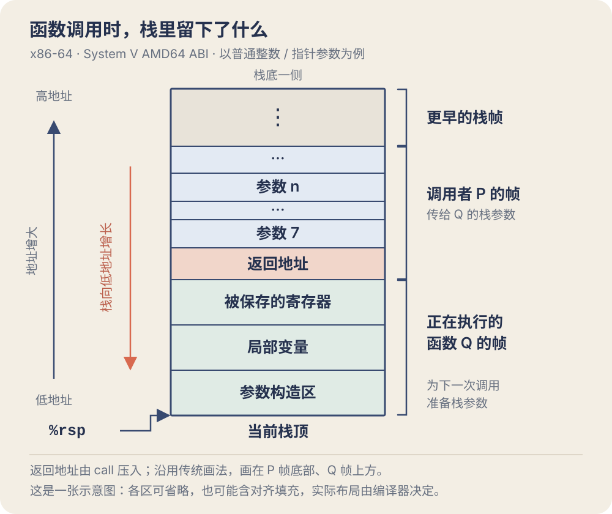

第二章讨论的是一串位可以怎样解释，到了第三章，这些位开始真正参与程序的执行。C 语言里的一次加法、一个数组下标、一次函数调用，最后都要落实成寄存器和内存的变化。

读汇编时，容易被一条条指令绕晕。我的理解是，可以先盯着三个问题：数据现在放在哪里，这条指令改了什么，下一条指令会从哪里执行。把这几件事连起来，原本看起来很混乱的代码就能慢慢还原成 C 程序的意思。

本文以 **Linux 下的 x86-64、System V AMD64 ABI 和 AT&T 汇编语法**为例。ABI 约定了参数怎么传、哪些寄存器要保存等细节；下面的汇编主要用于解释语义，省略了调试信息等指示符，不保证与某个版本的 GCC 输出逐字相同。

- [从 C 文件到机器指令](#从-c-文件到机器指令)
- [数据格式与寄存器](#数据格式与寄存器)
- [寻址与数据传送](#寻址与数据传送)
- [算术与逻辑运算](#算术与逻辑运算)
- [条件与控制流](#条件与控制流)
- [函数调用与运行时栈](#函数调用与运行时栈)
- [数组的分配与访问](#数组的分配与访问)
- [结构体联合体与对齐](#结构体联合体与对齐)
- [用 GDB 看一次实际执行](#用-gdb-看一次实际执行)
- [缓冲区溢出与栈保护](#缓冲区溢出与栈保护)
- [浮点数的机器级操作](#浮点数的机器级操作)

## 从 C 文件到机器指令

### 预处理、编译、汇编、链接

平时一条 `gcc prog.c -o prog` 就能生成可执行文件，但这条命令背后有几个不同的阶段：

```text
prog.c  →  prog.i  →  prog.s  →  prog.o  →  prog
       预处理     编译       汇编       链接
```

**预处理**展开 `#include`、宏和条件编译，把源文件整理成编译器接下来要处理的文本。**编译**完成语法、类型等分析和优化，生成汇编代码。**汇编**把指令编码成机器码，形成可重定位目标文件。此时已经有机器指令，但外部函数或全局对象的地址可能还没确定。

**链接**将目标文件、所需库代码及启动代码组织到一起，解析符号并完成必要的重定位，生成可执行文件。使用动态链接时，一部分符号解析和地址处理还会留给装载器与动态链接器。

可以让 GCC 在各个阶段停下来：

```bash
gcc -E prog.c -o prog.i          # 只做预处理
gcc -Og -S prog.i -o prog.s      # 编译成汇编，便于对照源代码
gcc -c prog.s -o prog.o          # 汇编成目标文件
gcc prog.o -o prog              # 链接；这里假设 prog.c 中有 main
```

`-E`、`-S` 和 `-c` 表示“在哪里停止”，不是三个必须同时使用的开关。直接执行 `gcc -Og -S prog.c`，也会先做预处理，再停在汇编输出这一步。`-Og` 是适合调试的优化级别；想看优化怎样改变代码，可以再对比 `-O1` 或 `-O2` 的结果。

### 反汇编能看见什么

汇编是从文本指令得到机器码，**反汇编**则从机器码解读出指令：

```bash
objdump -d prog.o                # 反汇编目标文件的代码段
objdump -dr prog.o               # 同时显示重定位信息
objdump -d prog                  # 查看链接后的指令
gcc -Og -g prog.c -o prog
objdump -S prog                  # 有调试信息和源文件时，混合显示 C 与汇编
```

目标文件里的一条 `call` 可能暂时看不出正确的被调用地址，`-r` 显示的重定位记录可以补上这部分信息。链接之后再查看，可看到链接器已经确定的地址或相应的动态链接入口。

反汇编不会把变量名、类型、注释和原来的 `for` 循环完整还原出来。同一段机器码可能来自多种 C 写法；我们做的是根据数据流和控制流推断含义。后面的命令按 GNU/Linux 工具链书写。

## 数据格式与寄存器

### 数据格式

x86-64 的内存按字节寻址，并采用小端序。指令中的 `b`、`w`、`l`、`q` 用来区分整数操作宽度：

| C 类型（本文的 LP64 环境） | 大小 | x86 名称 | 常见整数指令后缀 |
| --- | ---: | --- | --- |
| `char` | 1 字节 | byte | `b` |
| `short` | 2 字节 | word | `w` |
| `int` | 4 字节 | double word | `l` |
| `long`、`long long` | 8 字节 | quad word | `q` |
| 指针 | 8 字节 | quad word | `q` |
| `float` | 4 字节 | 单精度浮点数 | 标量浮点指令常用 `ss` |
| `double` | 8 字节 | 双精度浮点数 | 标量浮点指令常用 `sd` |

这里有一个容易混淆的地方：x86 指令里的 **word 固定指 16 位**，不要因为处理器是 64 位，就把 `movw` 理解成传送 64 位。类似地，`movl` 的 `l` 表示传送 32 位，也不等于这里 C 语言 `long` 的大小。

类型信息并不完整地存在于指令里。加法通常不区分有符号和无符号，比较、扩展、除法等操作才会体现不同解释。看到一条 `addq`，只能直接知道它做的是 64 位加法。

### 16 个通用寄存器

寄存器是处理器内部直接参与运算的存储位置。先按函数调用时的用途来记，比按名字顺序背更有用：

| 分类 | 寄存器 | 常见用途 | 跨函数调用时的约定 |
| --- | --- | --- | --- |
| 栈指针 | `%rsp` | 指向当前栈顶 | 返回时必须恢复到调用者所需的位置 |
| 返回值 | `%rax` | 普通整数、指针返回值；乘除法隐含操作数 | 调用者保存 |
| 参数 1、2 | `%rdi`、`%rsi` | 前两个整数或指针参数 | 调用者保存 |
| 参数 3、4 | `%rdx`、`%rcx` | 第三、第四个整数或指针参数 | 调用者保存 |
| 参数 5、6 | `%r8`、`%r9` | 第五、第六个整数或指针参数 | 调用者保存 |
| 临时值 | `%r10`、`%r11` | 临时计算 | 调用者保存 |
| 需要跨调用保留的值 | `%rbx`、`%r12`、`%r13`、`%r14`、`%r15` | 由编译器分配 | 被调用者保存 |
| 帧指针或一般用途 | `%rbp` | 可作为当前栈帧的稳定基址 | 被调用者保存 |

正好是 16 个。表里的用途并不是给每个寄存器永久贴上标签：传完参数后，`%rdi` 也能参与普通计算；不使用帧指针时，`%rbp` 也可以存别的数据。`%rdx` 除了传参，还参与宽乘除法，也可能承载较宽返回值的一部分。

“调用者保存”是说，如果 P 调用 Q，而 P 还想在 Q 返回后使用某个旧值，P 自己要先把它保存在可靠的位置。“被调用者保存”则是说，Q 若改动了这类寄存器，返回前就必须还原。并不要求每次调用都把表里的所有寄存器压栈。

另外还有保存指令位置的 `%rip` 和包含条件码的 `%rflags`，它们不计入这 16 个通用寄存器。

### 一个寄存器的不同宽度

`%rax`、`%eax`、`%ax`、`%al` 不是四块独立空间，而是同一个寄存器的不同部分：

| 64 位 | 低 32 位 | 低 16 位 | 低 8 位 |
| --- | --- | --- | --- |
| `%rax` | `%eax` | `%ax` | `%al` |
| `%rbx` | `%ebx` | `%bx` | `%bl` |
| `%rcx` | `%ecx` | `%cx` | `%cl` |
| `%rdx` | `%edx` | `%dx` | `%dl` |
| `%rsi` | `%esi` | `%si` | `%sil` |
| `%rdi` | `%edi` | `%di` | `%dil` |
| `%rbp` | `%ebp` | `%bp` | `%bpl` |
| `%rsp` | `%esp` | `%sp` | `%spl` |
| `%r8`～`%r15` | `%r8d`～`%r15d` | `%r8w`～`%r15w` | `%r8b`～`%r15b` |

**写入 32 位通用寄存器，会把对应 64 位寄存器的高 32 位清零；写入低 8 位或低 16 位，通常保留其余位。**

```asm
movq $-1, %rax      # rax = 0xffffffffffffffff
movb $0, %al        # rax = 0xffffffffffffff00
movl $1, %eax       # rax = 0x0000000000000001
```

因此常见的 `xorl %eax, %eax` 能把整个 `%rax` 清零。这里的“高位清零”专指寄存器目的操作数：`movl %eax, (%rdi)` 只写 4 字节内存，并不会顺手清掉后面的 4 字节。

此处可以根据计算机系统的发展历史来理解和记忆，最初计算机有 8 个 16 位寄存器；
扩展到 IA32 架构后，扩展为 32 位寄存器，数量不变；
后续又扩展到 x86-64 架构，变为 16 个 64 位寄存器，新增的 8 个寄存器，命名规是 %r8-%r15。

## 寻址与数据传送

### 先分清值、寄存器和内存

AT&T 语法通常把**源操作数写在前，目的操作数写在后**：

```asm
movq $8, %rax       # 立即数 8 → rax
movq %rax, %rdx     # rax 的内容 → rdx
movq (%rax), %rdx   # 以 rax 为地址，读 8 字节 → rdx
```

`$8` 是数字 8，`%rax` 是寄存器中的值，`(%rax)` 才表示访问这个值所指向的内存。把地址本身和地址里的内容混在一起，后面的指针、数组都会难读。

大多数普通整数 `mov` 不能让源和目的同时是内存，因此内存之间复制一个值往往需要寄存器中转：

```asm
movq (%rdi), %rax
movq %rax, (%rsi)
```

普通 `mov` 不修改条件码。64 位立即数还有编码上的限制：任意 64 位常量装入寄存器时可用 `movabsq`，如 `movabsq $0x123456789abcdef0, %rax`；不能认为每条带立即数的 `q` 指令都能直接放入任意 64 位常量。

### 内存寻址

常见的内存操作数写成：

$$
D(R_b,R_i,S)
$$

对应的有效地址为：

$$
\mathrm{EA}=D+R_b+R_i\times S
$$

其中 `D` 是位移，`Rb` 是基址寄存器，`Ri` 是变址寄存器，比例因子 `S` 只能取 **1、2、4、8**。某些部分可以省略；普通的比例变址形式不能把 `%rsp` 用作变址寄存器。

假设 `%rax = 0x100`、`%rcx = 3`：

| 形式 | 示例 | 算出的地址 |
| --- | --- | --- |
| 绝对地址 | `0x100` | `0x100`，注意没有 `$` |
| 寄存器间接寻址 | `(%rax)` | `0x100` |
| 基址加位移 | `8(%rax)` | `0x108` |
| 基址加变址 | `(%rax,%rcx)` | `0x103` |
| 位移加比例变址 | `8(,%rcx,4)` | `0x14` |
| 基址加比例变址 | `(%rax,%rcx,8)` | `0x118` |
| 完整形式 | `16(%rax,%rcx,8)` | `0x128` |

读数组时最常见的是最后两种：基址指向数组开头，变址是下标，比例因子是元素字节数。

还会遇到 `name(%rip)` 这样的 **RIP 相对寻址**。它用下一条指令的地址加上编码中的位移访问目标，常用于全局数据和位置无关代码。

### 扩展与截断

把小类型读入大寄存器时，需要决定高位怎么补：

| 指令 | 含义 |
| --- | --- |
| `movzbq S, R` | 8 位零扩展为 64 位 |
| `movzwq S, R` | 16 位零扩展为 64 位 |
| `movsbq S, R` | 8 位符号扩展为 64 位 |
| `movswq S, R` | 16 位符号扩展为 64 位 |
| `movslq S, R` | 32 位符号扩展为 64 位 |

例如低字节是 `0xff`，零扩展得到 `255`，符号扩展得到 `-1`。32 位无符号数扩展到 64 位通常直接写 32 位目的寄存器即可：

```asm
movl   (%rdi), %eax    # 读 unsigned int，高 32 位自动清零
movslq (%rdi), %rax    # 读 int，符号扩展到 64 位
```

截断反过来更直接：只取低位子寄存器，或者只写出需要的字节数。例如 `movb %al, (%rdi)` 只保存低 8 位。

### 入栈与出栈

栈向低地址增长。对于普通寄存器操作数，`pushq %rax` 可以理解为：

```text
rsp = rsp - 8
M[rsp] = rax
```

`popq %rax` 则相当于：

```text
rax = M[rsp]
rsp = rsp + 8
```

出栈只是改变栈指针并取出数据，通常不会把原内存清零。这也是为什么“函数返回后局部变量的字节看起来还在”，不能作为继续访问它的理由：对象的生命周期已经结束，后续调用可以立即覆盖那片空间。

## 算术与逻辑运算

### 常见的整数运算

下面统一用 `q` 后缀，`S` 表示源，`D` 表示目的；二元运算通常会覆盖 `D`：

| 指令 | 操作 |
| --- | --- |
| `addq S, D` | `D = D + S` |
| `subq S, D` | `D = D - S` |
| `incq D`、`decq D` | 加 1、减 1 |
| `negq D` | 求相反数 |
| `andq S, D` | 按位与 |
| `orq S, D` | 按位或 |
| `xorq S, D` | 按位异或 |
| `notq D` | 按位取反 |

`and`、`or`、`xor` 是按位运算，不会自动实现 C 的短路求值。`p != NULL && *p > 0` 仍然需要保证只有在 `p` 有效时才解引用。

机器上的整数结果受位宽限制，但不能因此把 C 的有符号溢出当作合法的环绕运算。汇编描述机器怎么做，C 语言标准约束程序允许依赖什么，这两层要分开。

### leaq：长得像访问内存，却没有读内存

`leaq` 的名字是“加载有效地址”，但它只计算寻址表达式，不访问这个地址中的数据：

```asm
movq 8(%rdi), %rax       # 读 M[rdi + 8]
leaq 8(%rdi), %rax       # 算 rdi + 8
```

这一点让 `leaq` 也能用来做普通算术。假设 `%rdi` 存的是整数 `x`：

```asm
leaq (%rdi,%rdi,4), %rax      # rax = 5*x
leaq 12(%rdi,%rsi,8), %rax   # rax = x + 8*y + 12
leaq (,%rdi,8), %rax         # rax = 8*x
subq %rdi, %rax              # rax = 7*x
```

`leaq` **不改变条件码**，而 `addq` 等算术指令通常会改变。编译器有时会利用这一区别安排指令。它也不是可以塞进任意算式的工具，仍然受基址、变址和比例因子的编码限制；更不能仅凭“少一条指令”就断言一定更快。

### 移位

| 指令 | 含义 |
| --- | --- |
| `salq`、`shlq` | 左移，二者在这里是同一种操作 |
| `sarq` | 算术右移，复制符号位 |
| `shrq` | 逻辑右移，左侧补零 |

移位次数可以是立即数，也可以来自 `%cl`：

```asm
shlq $3, %rax       # 左移 3 位
sarq %cl, %rax      # 按 cl 给出的次数算术右移
```

64 位操作只使用计数的低 6 位；32 位操作使用低 5 位。例如机器指令的 64 位移位计数为 `64` 时，实际等同于移位 `0`。但 C 语言中，移位次数大于等于类型位宽属于未定义行为，不能借这个硬件规则写 C 代码。

算术右移负数相当于向负无穷取整，C 的有符号除法却向零截断。因此 `-7` 算术右移一位得到 `-4`，而 `-7 / 2` 得到 `-3`；编译器把除法改写成移位时，可能需要先加偏置。

### imulq、cltq 与 cqto

`imulq` 有几种形式，不能只看名字就认为结果总在 `%rax`：

| 形式 | 结果 |
| --- | --- |
| `imulq S, D` | `D = D * S`，保留低 64 位 |
| `imulq $k, S, D` | `D = S * k`，保留低 64 位 |
| `imulq S` | `%rax` 与 `S` 做有符号乘法，完整 128 位结果放在 `%rdx:%rax` |
| `mulq S` | 对应的无符号宽乘法，结果也放在 `%rdx:%rax` |

`%rdx:%rax` 表示高 64 位在 `%rdx`、低 64 位在 `%rax`，不是两个寄存器相加。同样两个位模式相乘，有符号和无符号解释的低 64 位相同，完整乘积的高位却可能不同。

宽除法与它们配套：

```asm
# long x / long y：入口 x 在 rdi，y 在 rsi
movq %rdi, %rax
cqto
idivq %rsi          # 商在 rax，余数在 rdx
```

`idivq` 把 `%rdx:%rax` 作为 128 位有符号被除数。`cqto` 将 `%rax` 的符号位复制到 `%rdx`，使一个 64 位有符号数正确扩展到 128 位：非负数的 `%rdx` 全为零，负数的 `%rdx` 全为一。无符号除法 `divq` 若处理的是普通 64 位被除数，通常先用 `xorl %edx, %edx` 把高半部分清零。

另一个名字相近的指令是 `cltq`：

```asm
cltq                # eax → rax，32 位符号扩展为 64 位
cqto                # rax → rdx:rax，64 位符号扩展为 128 位
```

GNU 的 AT&T 语法写作 `cqto`，Intel 语法写作 `cqo`。`cltq` 和 `cqto` 都没有显式操作数。`cltq` 相当于 `movslq %eax, %rax`，并不改动 `%rdx`。

除数为零，或商无法放入目标寄存器时，除法会触发异常。例如有符号最小值除以 `-1` 就无法得到可表示的 64 位商。

## 条件与控制流

### 条件码

处理器会把一些运算结果的性质记录在条件码里。本章最常用的是：

| 条件码 | 含义 |
| --- | --- |
| `CF` | 无符号加法的进位；做减法时反映借位 |
| `ZF` | 结果是否为零 |
| `SF` | 结果最高位，即符号位 |
| `OF` | 按有符号数解释时是否溢出 |

`cmpq S, D` 按 `D - S` 设置条件码，却不保存减法结果。`testq S, D` 按 `D & S` 设置条件码，也不写回结果：

```asm
cmpq  %rsi, %rdi    # 比较 x 与 y，依据 x - y
testq %rax, %rax    # 判断 rax 是零、正数还是负数
```

`testq %rax, %rax` 用来判零很常见。`test`、`and`、`or`、`xor` 会清除 `CF` 和 `OF`，并按结果设置 `ZF`、`SF`。`inc`、`dec` 不修改 `CF`；`not` 不修改条件码。读汇编时不能只找“最近的一次比较”，还要检查中间有没有指令覆盖了需要的标志位。

### 有符号比较与无符号比较

同样的 `cmpq %rsi, %rdi`，后面接不同的指令，就会得到不同解释：

| 关系（`x` 对 `y`） | 条件 | 跳转 | 设置字节 | 条件传送 |
| --- | --- | --- | --- | --- |
| 相等 | `ZF` | `je` | `sete` | `cmove` |
| 不等 | `!ZF` | `jne` | `setne` | `cmovne` |
| 有符号小于 | `SF != OF` | `jl` | `setl` | `cmovl` |
| 有符号小于等于 | `ZF \|\| (SF != OF)` | `jle` | `setle` | `cmovle` |
| 有符号大于 | `!ZF && (SF == OF)` | `jg` | `setg` | `cmovg` |
| 有符号大于等于 | `SF == OF` | `jge` | `setge` | `cmovge` |
| 无符号小于 | `CF` | `jb` | `setb` | `cmovb` |
| 无符号小于等于 | `CF \|\| ZF` | `jbe` | `setbe` | `cmovbe` |
| 无符号大于 | `!CF && !ZF` | `ja` | `seta` | `cmova` |
| 无符号大于等于 | `!CF` | `jae` | `setae` | `cmovae` |

这里的条件传送列只写条件部分，实际 64 位指令如 `cmovlq`、`cmovgeq` 还带宽度后缀。`setcc` 只写一个字节，经常再零扩展成 C 的 `int`：

```asm
# int less(long x, long y)
cmpq   %rsi, %rdi
setl   %al
movzbl %al, %eax
ret
```

有符号“小于”不能只看 `SF`。减法若发生溢出，结果的符号位可能与数学上的正负相反，所以要结合 `OF` 修正。

### 条件跳转与条件传送

对于 `return x < y ? x : y;`，一种实现是让控制流走不同的路：

```asm
movq %rsi, %rax
cmpq %rsi, %rdi
jge  .Ldone
movq %rdi, %rax
.Ldone:
ret
```

也可以先准备默认结果，再根据条件换掉它：

```asm
movq   %rsi, %rax
cmpq   %rsi, %rdi
cmovlq %rdi, %rax
ret
```

前者是**条件控制**，改变下一条指令的位置；后者是**条件传送**，控制流保持直线，只决定是否更新结果。难以预测的分支可能带来流水线代价，`cmov` 可以在某些场景减少这种代价，但它不是所有 `if` 的通用替代品。

例如：

```c
long read_or_zero(const long *p) {
    return p ? *p : 0;
}
```

不能先无条件读取 `*p`，再用条件传送决定保不保留结果。即使把内存操作数直接放进 `cmov`，条件不满足时也可能因为源内存访问而产生异常；`cmov` 不能替代这里保护解引用的分支。带副作用或求值成本很高的两条分支，也不适合简单地“两边都算”。

### do-while、while 与 for

机器没有专门的 `while` 指令。循环最终靠标签、条件和向后跳转组成。先看三种循环各自把判断放在哪里。

`do-while` 先执行循环体，至少执行一次：

```c
long i = 0, sum = 0;
do {
    sum += i;
    ++i;
} while (i < n);
```

它的控制流可以直接写成：

```text
body:
    sum += i
    i += 1
    if i < n: goto body
```

`while` 则必须先检查条件；即使一次循环体都不执行，也符合它的语义：

```c
long i = 0, sum = 0;
while (i < n) {
    sum += i;
    ++i;
}
```

一种实现方式是先跳到测试处：

```asm
# n 在 rdi，sum 在 rax，i 在 rdx
xorl %eax, %eax
xorl %edx, %edx
jmp  .Ltest
.Lbody:
addq %rdx, %rax
addq $1, %rdx
.Ltest:
cmpq %rdi, %rdx
jl   .Lbody
ret
```

另一种常见方式是在入口先做一次判断，条件成立才进入类似 `do-while` 的循环体。源码写的是 `while`，不代表汇编里的条件判断一定只出现在循环体前面。

`for` 多了一次初始化和每轮结束时的更新：

```c
long sum = 0;
for (long i = 0; i < n; ++i) {
    sum += i;
}
```

```text
    i = 0
test:
    if i >= n: goto done
body:
    sum += i
update:
    i += 1
    goto test
done:
```

它完全可能和前面的 `while` 编译成相同的指令。一个值得单独记住的区别是 `continue` 的目标：在 `for` 中要先执行更新表达式，再判断条件；在 `while` 和 `do-while` 中则直接去相应的条件测试处。`break` 跳到整个循环之后。

### switch 与跳转表

`switch` 的分支较少或取值稀疏时，可以用一串比较，或者用树形比较。取值集中时，编译器还可以把“找分支”变成一次索引操作。

```c
long choose(long k, long x) {
    switch (k) {
    case 10:
        return x + 1;
    case 11:
        ++x;
        /* fall through：继续执行 case 12 */
    case 12:
        return x * 2;
    case 14:
        return x - 1;
    default:
        return 0;
    }
}
```

先计算 `k - 10`，把 `10～14` 变成 `0～4`。表中下标 `3` 对应缺失的 `case 13`，填入默认分支即可。一种位置无关的实现如下；这是用于说明机制的手写版本，编译器也可能选择其他实现：

```asm
choose:
    subq   $10, %rdi
    cmpq   $4, %rdi
    ja     .Ldefault
    leaq   .Ltable(%rip), %rdx
    movslq (%rdx,%rdi,4), %rax
    addq   %rdx, %rax
    jmp    *%rax

.L10:
    leaq   1(%rsi), %rax
    ret
.L11:
    addq   $1, %rsi
.L12:
    leaq   (%rsi,%rsi), %rax
    ret
.L14:
    leaq   -1(%rsi), %rax
    ret
.Ldefault:
    xorl   %eax, %eax
    ret

    .section .rodata
    .p2align 2
.Ltable:
    .long .L10 - .Ltable
    .long .L11 - .Ltable
    .long .L12 - .Ltable
    .long .Ldefault - .Ltable
    .long .L14 - .Ltable
```

这里 `ja` 做无符号比较，既能排除大于 `4` 的正常下标，也能排除原来 `k < 10` 时减法产生的环绕值。随后取出一个带符号的 32 位相对偏移，加上表的基址，再间接跳转。`jmp *%rax` 中的 `*` 表示跳转目标来自寄存器。

跳转表也可以存完整地址，此时 64 位地址通常占 8 字节；不要看到跳转表就默认比例因子一定是 `8`。上面存的是 4 字节相对偏移，所以用了 `4`。`case 11` 没有 `break`，对应的指令也自然落入了 `.L12`。

## 函数调用与运行时栈

函数调用要让执行转到另一段代码，把参数交过去，并在结束后回到正确的位置。寄存器数量有限，一个函数还可能继续调用其他函数，因此还需要一块能随调用进入、随返回退出的存储空间。

### call 与 ret

普通的近调用 `call Q` 会把它后面那条指令的地址压栈，再跳到 Q。`ret` 从栈顶取回地址，继续在那里执行。对于本章的 64 位调用，返回地址占 8 字节。

`call` 不会自动保存所有寄存器，也不会自动替 Q 建好完整栈帧。保存寄存器、分配局部空间，通常由函数自己的指令完成。

对于普通整数和指针参数，前六个依次放进 `%rdi`、`%rsi`、`%rdx`、`%rcx`、`%r8`、`%r9`。如果参数全是 `long`，第七个开始使用栈。在 Q 刚进入、尚未调整 `%rsp` 时：

```text
0(%rsp)    返回地址
8(%rsp)    第 7 个 long 参数
16(%rsp)   第 8 个 long 参数
```

这不是说“任何函数的第七个参数都上栈”：浮点参数有独立的寄存器序列，结构体等参数还要按 ABI 分类。

### 通用栈帧

下面按 P 调用 Q、Q 正在执行的状态画出通用结构。上方地址更大，下方地址更小；栈增长时，`%rsp` 向下移动。



P 把放不进参数寄存器的参数留在栈上，`call` 再压入返回地址。Q 根据需要保存寄存器，给局部数据腾出空间；如果 Q 还要调用别的函数，它也可能预留自己的参数构造区。图中沿用书里的归组方式，把返回地址画在 P 帧底部，它在物理上紧挨着 Q 的保存区。

这是一张“可能有什么”的示意图。没有局部数组、不需要保存寄存器的叶子函数，可能几乎没有图中那些区域。局部变量也未必在栈上，它们可以一直待在寄存器里，甚至直接被优化掉。

### 建立和释放栈帧

一个保留帧指针的简单函数可能有下面的框架：

```asm
pushq %rbp
movq  %rsp, %rbp
subq  $32, %rsp

# 函数体；假设局部数据需要 32 字节
# 可用 -8(%rbp) 等固定偏移访问局部位置

movq  %rbp, %rsp
popq  %rbp
ret
```

`%rbp` 在函数体内保持稳定，`%rsp` 则可以继续变化。最后的 `movq %rbp, %rsp; popq %rbp` 也可以由 `leave` 完成。不过，优化后的代码经常省略帧指针，直接用 `%rsp` 加偏移访问固定栈位置。

这里的 32 字节是分配出来的地址范围，不代表对应内存被初始化为零。`subq` 只是把栈指针下移。

还要留意**栈对齐**。普通 System V x86-64 调用在执行 `call` 前要求 `%rsp` 按 16 字节对齐；`call` 压入 8 字节返回地址后，Q 入口处满足的是：

$$
(\%rsp+8)\bmod16=0
$$

上面的 `pushq %rbp` 又减去 8 字节，随后减去 32 字节，保持了可继续调用其他普通函数所需的对齐。某些高对齐参数会提出更强的要求，不能把 16 字节当成所有场景的上限。

System V ABI 还保留了 `%rsp` 以下的 **128 字节 red zone**，信号和中断处理程序不应破坏它。叶子函数有时可以在这里放临时数据，省去调整栈指针的指令。但不能依靠它保存需要跨普通函数调用存活的数据。这些规则来自 [ABI 的栈帧约定](https://gitlab.com/x86-psABIs/x86-64-ABI/-/blob/master/x86-64-ABI/low-level-sys-info.tex)，不是 `push` 指令本身规定的。

### 为什么递归也能正常返回

递归并不需要另一套机器指令。同一个函数再次被调用时，会产生新的返回地址和本次调用需要的存储空间。只要按约定保存状态，后一次调用就不会覆盖前一次仍要使用的值。

真正区分每一次调用的，不是函数代码的副本，而是当时的寄存器状态和栈上的数据。递归层数太深时，这些空间不断积累，才会耗尽可用栈空间。

## 数组的分配与访问

### 定长数组

对于 `T A[N]`，数组元素连续存放。若首地址为 `x_A`、每个元素占 `L` 字节，则：

$$
\operatorname{addr}(A[i])=x_A+iL
$$

例如 `long A[8]` 占 64 字节。如果 `%rdi` 是首地址，`%rsi` 是下标：

```asm
movq (%rdi,%rsi,8), %rax      # A[i]
leaq (%rdi,%rsi,8), %rax      # &A[i]
```

两个表达式只差一个取地址符，汇编却正好对应“读数据”和“算地址”的区别。`A + i` 每增加一个下标，要移动 `sizeof(*A)` 字节，并不是增加一个字节。

局部定长数组如果确实需要内存，编译器可以在编译时决定所需栈空间和偏移；静态存储期的数组则位于相应的数据区域。大小固定不意味着一定在栈上，也不意味着一定没有被优化掉。

### 二维数组和指针数组

C 的二维数组采用行优先顺序：

```c
int A[3][5];
```

先存第一行的 5 个 `int`，再存第二行。其地址为：

$$
\operatorname{addr}(A[i][j])
=x_A+(i\times5+j)\times4
$$

一种访问方式是：

```asm
# rdi = A，rsi = i，rdx = j
leaq  (%rsi,%rsi,4), %rax     # 5*i
addq  %rdx, %rax             # 5*i + j
movl  (%rdi,%rax,4), %eax     # A[i][j]
```

二维数组不能和 `int *P[3]` 混为一谈。后者是“含 3 个指针的数组”，先读出 `P[i]`，才知道第 i 行放在哪里：

```asm
# rdi = P，rsi = i，rdx = j
movq (%rdi,%rsi,8), %rax     # 先取行指针 P[i]
movl (%rax,%rdx,4), %eax     # 再取这一行的第 j 个 int
```

`int A[3][5]` 在表达式中通常退化为 `int (*)[5]`，即“指向一行的指针”；它不是 `int **`。前者通过固定行跨度算地址，后者需要读取指针。即使写出来都像 `a[i][j]`，底下的数据布局也不同。

### 变长数组

变长数组（VLA）的大小在执行到声明时确定：

```c
void work(long n) {
    if (n <= 0 || n > 1024)
        return;
    long a[n];
    /* 在这里使用 a；假设这些访问不能被优化掉 */
}
```

在本章讨论的常见 GCC 实现中，这类自动数组通常动态分配在栈上。需要的字节数为 `8*n`，还要满足对齐。若当前栈位置合适，分配量可理解为：

$$
B=16\left\lceil\frac{8n}{16}\right\rceil
$$

然后把 `%rsp` 减去 `B`。真实指令还要考虑固定局部区、对齐填充，以及退出作用域时如何恢复原位置。正因为调整量在运行时才知道，编译器可能保留 `%rbp` 或其他稳定基址。VLA 离开作用域后失效，不是 `malloc` 得来的堆对象，也不能返回指向它的指针。

行宽本身也可以是运行时值：

```c
int element(long rows, long cols,
            int a[rows][cols], long i, long j) {
    return a[i][j];
}
```

假设维度为正、下标合法，地址公式变为：

$$
\operatorname{addr}(a[i][j])
=x_a+(i\times cols+j)\times4
$$

`cols` 不再是编译时常量，计算行偏移时就可能需要 `imulq`，而不只是常量比例寻址。这里作为参数的 `a` 实际调整为 `int (*)[cols]`，函数入口不会因为这个声明重新分配一个二维数组。

无论定长还是变长，普通机器级寻址本身都不会替 C 数组检查边界。合法下标和可承受的分配大小仍然是程序要保证的事。

## 结构体联合体与对齐

### 结构体：基址加字段偏移

结构体把不同类型的数据放进同一块连续存储中。编译器根据布局规则确定每个成员的偏移，访问成员时通常就是一次固定偏移寻址：

```c
struct Record {
    char tag;
    long value;
    int count;
};
```

在本文的 ABI 下，`char`、`int`、`long` 的自然对齐要求分别为 1、4、8 字节。上面的布局是：

| 字节偏移 | 内容 |
| --- | --- |
| `0` | `tag` |
| `1～7` | 填充 |
| `8～15` | `value` |
| `16～19` | `count` |
| `20～23` | 尾部填充 |

因此 `sizeof(struct Record) == 24`，而不是把成员大小直接相加得到的 `13`。如果 `%rdi` 指向该结构体，`movq 8(%rdi), %rax` 就能读取 `value`。

对本例这类没有特殊对齐声明和位域的普通结构体，可以这样推算：按声明顺序放成员，把每个成员的起始偏移补到其对齐要求的倍数，最后把总大小补到最严格成员对齐要求的倍数。

尾部填充是为了数组。`struct Record a[2]` 中，第二个元素从第 24 字节开始，里面的 `long` 仍能满足 8 字节对齐。

调整成员顺序有时会减少填充：

```c
struct CompactRecord {
    long value;   // 0～7
    int count;    // 8～11
    char tag;     // 12
};                // 13～15 为填充，总大小 16
```

这种调整改变了布局，涉及文件格式、网络协议或已有 ABI 时，不能仅为节省几个字节就随意改顺序。填充字节也不属于成员值，不能普遍用 `memcmp` 代替逐成员比较。

### 联合体：几个成员共用起点

```c
union Value {
    long i;
    double d;
    char bytes[8];
};
```

三个成员都从偏移 `0` 开始，占用的是同一片空间。在这里联合体大小为 8 字节，对齐要求也为 8。一般而言，大小要能容纳最大的成员，并按联合体的对齐要求补齐；不是把所有成员大小相加。

写入 `v.d` 后，不能认为 `v.i` 还保留着先前的整数。联合体本身也不记录当前放的是哪种值，程序通常另外保存一个标签：

```c
struct Number {
    enum { INTEGER, REAL } kind;
    union {
        long i;
        double d;
    } value;
};
```

如果是想观察 `double` 的位模式，可以用 `memcpy` 复制到大小相同的 `uint64_t` 对象，再按整数查看。不要把“共用字节”误解成一次数值类型转换；读取另一个联合体成员还涉及语言版本和表示规则，不能套用同一套 C/C++ 结论。

### 为什么要对齐

对齐让一个对象的地址满足某个整数倍关系。它既关系到 ABI 兼容，也便于处理器高效访问；某些指令还直接要求特定对齐。

x86-64 的许多普通整数指令能访问未对齐地址，所以“没对齐必定崩溃”并不准确。但跨缓存行或跨页的访问可能增加代价，而需要对齐的向量指令不能随便使用。具体布局可以用 `sizeof`、`_Alignof` 和 `offsetof` 检查，不必完全靠心算。

可以简单记忆的对齐规则是：
（1）每个基本类型 k 字节，地址必须是 k 的倍数；
（2）结构体内部，每成员的偏移量必须是该成员自身对其要求的倍数；
（3）结构体整体的对齐要求 = 都有成员中最大的对齐要求；结构体总大小必须是这个对齐值的倍数。

## 用 GDB 看一次实际执行

只读静态汇编，`%rsp` 的变化很容易停留在想象里。调试时停在函数入口，看看参数寄存器和栈里的返回地址，再单步观察返回值，就能把静态汇编和一次实际执行对应起来。

下面这份小程序可以同时观察指针读取、参数传递和返回值：

```c
long add_at(const long *p, long delta) {
    long old = *p;
    return old + delta;
}

int main(void) {
    long x = 40;
    long result = add_at(&x, 2);
    return result != 42;
}
```

保存为 `prog.c`，在 x86-64 Linux 环境中执行：

```bash
gcc -Og -g -fno-omit-frame-pointer -fno-inline prog.c -o prog
gdb ./prog
```

这里保留调试信息、请求保留帧指针，并关闭内联，方便观察；简单的叶子函数仍可能没有完整序言。真实的优化代码可能没有对应的局部变量，也可能把几行 C 合并成一条指令。

```text
(gdb) set disassembly-flavor att
(gdb) break *add_at
(gdb) run
(gdb) disassemble /r add_at
(gdb) info registers rdi rsi rax rsp rbp rip
(gdb) x/gd $rdi
(gdb) x/4gx $rsp
(gdb) display/i $pc
(gdb) stepi
```

`break *add_at` 停在函数第一条指令，便于观察序言执行前的栈；普通的 `break add_at` 通常按源代码位置设置断点，可能越过序言。停住后，`%rdi` 指向 `x`，`%rsi` 中是 `2`；`x/gd $rdi` 以 8 字节十进制整数查看指针所指的数据，应看到 `40`。

几条常用命令放在一起备查：

| 命令 | 用途 |
| --- | --- |
| `break main` / `b main` | 设置断点 |
| `run` / `r` | 开始运行 |
| `continue` / `c` | 继续到下一个断点或程序结束 |
| `step` / `s` | 按源代码单步，必要时进入函数 |
| `next` / `n` | 按源代码单步，通常跨过函数调用 |
| `stepi` / `si` | 执行一条机器指令，可进入调用 |
| `nexti` / `ni` | 按指令前进，跨过函数调用 |
| `finish` | 运行到当前函数返回 |
| `disassemble /r add_at` | 显示函数汇编与指令字节 |
| `info registers` | 查看寄存器 |
| `p/x $rax` | 以十六进制打印寄存器值 |
| `x/8gx $rsp` | 从栈顶开始查看 8 个八字节值 |
| `x/6i $rip` | 从当前指令地址反汇编 6 条指令 |
| `bt`、`frame 1` | 查看调用链、切换所观察的栈帧 |
| `watch x` | 在当前作用域内监视变量 `x` 的变化 |
| `quit` / `q` | 退出 |

`x/nfu address` 中，`n` 是数量，`f` 是显示格式，`u` 是单位大小。`x/8gx` 的 `g` 表示 8 字节单位，`x` 表示十六进制；`x/16bx` 则按字节查看。它检查的是指定地址的内存，不依赖那里原来声明了什么 C 类型。格式可查 [GDB 内存检查文档](https://sourceware.org/gdb/current/onlinedocs/gdb.html/Memory.html)，源代码与指令单步的区别见 [执行控制文档](https://sourceware.org/gdb/current/onlinedocs/gdb.html/Continuing-and-Stepping.html)。

遇到 `<optimized out>`，先不要怀疑调试器坏了。变量可能根本没有独立存储位置，或者它的值在当前指令处已经不再需要。此时回到寄存器和反汇编，往往比继续打印变量名更有用。

## 缓冲区溢出与栈保护

### 越界写入为什么会影响控制流

数组的边界是 C 程序中的约束，普通的存储指令只拿到地址和要写的字节，并不知道“这个缓冲区到这里就结束了”。

```c
#include <string.h>

void copy_name(const char *src) {
    char buf[16];
    strcpy(buf, src);  // src 连同末尾 '\0' 若超过 16 字节，就会越界
    /* 使用 buf */
}
```

如果这个缓冲区实际位于栈上，连续向后写出的字节可能破坏相邻局部数据、保存的寄存器和返回地址。具体能覆盖到什么取决于编译器布局与保护措施，不能根据源码声明顺序推断准确位置。

值得对照栈图想一下：**栈向低地址增长，数组按下标递增写入却走向高地址**。二者并不矛盾，也正因为如此，栈中数组的越界写入可能碰到位于其上方的返回信息。

后果可能是数据静默损坏、访问异常、程序崩溃，也可能是在返回地址或函数指针被破坏后改变控制流。缓冲区溢出还可能发生在堆和全局区域，不仅限于栈。

### 栈随机化、金丝雀与 NX

这些保护处理的是不同环节，可以一起使用：

| 方法 | 做了什么 | 主要限制 |
| --- | --- | --- |
| 栈随机化 / ASLR | 让栈及其他部分内存区域的位置在不同运行间变化，降低地址的可预测性 | 没有阻止越界写本身；地址泄露会削弱效果 |
| 金丝雀值（stack canary） | 在受保护函数的栈帧中放入检查值，在返回前验证是否被破坏 | 只覆盖被插桩的函数和能够触及检查值的破坏路径 |
| NX（不可执行页） | 将栈等数据页标记为不可执行，阻止直接在那里执行写入的字节 | 没有阻止数据破坏，也不能单独阻止对已有代码的滥用 |

栈随机化是地址空间布局随机化的一部分。Linux 中栈、`mmap` 区域、共享库和堆等区域的随机化范围取决于配置；可执行文件的代码地址能否随机化，还与是否构建为 PIE 有关。具体范围见 [Linux 的 ASLR 配置说明](https://docs.kernel.org/admin-guide/sysctl/kernel.html#randomize-va-space)。

金丝雀值可以理解为放在容易被连续越界写经过的位置上的检查值。函数进入时保存它，返回前再核对，发现变化就终止程序，而不是继续使用可能被改写的返回信息。GCC 的 `-fstack-protector-strong` 会为符合条件的函数插入这类保护；它不是对每一次内存写入都做边界检查，详见 [GCC 栈保护选项](https://gcc.gnu.org/onlinedocs/gcc/Instrumentation-Options.html)。

NX 则是页访问权限的一部分：一块内存可以允许读写，但不允许从中取指执行。这样即使某些输入字节进入了栈，也不会自动变成可执行代码。

回到代码层面，仍然要正确计算容量、检查输入长度，并为字符串结尾的 `'\0'` 留出空间。例如 `fgets(buf, sizeof buf, stdin)` 能限制本次写入量，但还要检查返回值和输入是否被截断。防护机制不能代替这些边界条件。调试阶段还可以用 AddressSanitizer 帮助发现越界访问。

## 浮点数的机器级操作

### XMM 寄存器与参数传递

第二章已经讨论过 IEEE 754 的位表示。到了机器级，普通 `float`、`double` 的运算主要使用另一组寄存器和指令。

本章使用的 x86-64 SSE/AVX 模型中，有 `%xmm0～%xmm15` 共 16 个 XMM 寄存器，每个 128 位。**寄存器有 128 位，不代表一次标量运算就使用全部 128 位**：单精度标量使用低 32 位，双精度标量使用低 64 位。AVX 的 YMM 寄存器为 256 位，其低 128 位与同编号 XMM 重叠，并不是独立的另一份数据。

System V ABI 下，普通浮点参数按顺序使用 `%xmm0～%xmm7`，标量浮点返回值放在 `%xmm0`。这些寄存器不保证跨函数调用保留。整数参数与浮点参数各自计数，例如：

```c
double combine(long n, double x, int k, float y);
```

对应 `n → %rdi`、`x → %xmm0`、`k → %esi`、`y → %xmm1`，不能把它们全塞进同一条“第几个参数”的队列。

这里主要讨论 `float` 和 `double`。`long double` 在本 ABI 中通常涉及 x87 扩展精度和另一套返回约定，不直接套用上面的规则。

### 传送与算术

`ss` 表示 scalar single，`sd` 表示 scalar double。SSE 的常见标量操作如下：

| 单精度 | 双精度 | 含义 |
| --- | --- | --- |
| `movss` | `movsd` | 传送标量浮点数据 |
| `addss` | `addsd` | 加法 |
| `subss` | `subsd` | 减法 |
| `mulss` | `mulsd` | 乘法 |
| `divss` | `divsd` | 除法 |
| `sqrtss` | `sqrtsd` | 平方根 |
| `ucomiss` | `ucomisd` | 比较并设置整数条件码 |

这些名字里的 `movsd` 在此指 SSE 双精度标量传送，要结合 XMM 操作数识别，不是字符串搬运指令。内存读写分别使用 4 或 8 字节；寄存器其余位如何保留或清零，还要看具体指令和编码，不能把通用寄存器的 `movl` 规则直接搬过来。

```c
double multiply_add(double a, double b, double c) {
    return a * b + c;
}
```

一份不使用融合乘加的 SSE 实现是：

```asm
# a 在 xmm0，b 在 xmm1，c 在 xmm2
mulsd %xmm1, %xmm0
addsd %xmm2, %xmm0
ret
```

CSAPP 中还常见带 `v` 前缀的 AVX 形式：

```asm
vmulsd %xmm1, %xmm0, %xmm0
vaddsd %xmm2, %xmm0, %xmm0
ret
```

AVX 算术指令可以把两个源和目的分开。AT&T 形式 `vsubsd S2, S1, D` 计算的是 `D = S1 - S2`，除法同样要注意顺序。上面仍然是标量运算，不能因为用了 AVX 就认为同时计算了多个 `double`。

是否生成 AVX 或融合乘加，取决于目标指令集、编译选项和允许的浮点优化。两条乘加指令会分别舍入，融合乘加则对组合运算只舍入一次，结果可能不同。

### 类型转换

整数寄存器与 XMM 寄存器之间传送位模式，不等于完成数值转换。要把整数 `3` 变成浮点数 `3.0`，需要转换指令：

| 指令示例 | 含义 |
| --- | --- |
| `cvtsi2sdq %rdi, %xmm0` | 有符号 64 位整数转 `double` |
| `cvtsi2ssl %edi, %xmm0` | 有符号 32 位整数转 `float` |
| `cvttsd2siq %xmm0, %rax` | `double` 向零截断为有符号 64 位整数 |
| `cvttss2sil %xmm0, %eax` | `float` 向零截断为有符号 32 位整数 |
| `cvtss2sd %xmm0, %xmm0` | `float` 转 `double` |
| `cvtsd2ss %xmm0, %xmm0` | `double` 转 `float` |

`cvtt` 里的第二个 `t` 表示截断，常用于 C 的浮点转整数。超出目标范围或输入 NaN 时，不能把硬件在特定异常屏蔽状态下给出的结果当作 C 的可移植语义。`double` 转 `float` 还可能舍入或溢出。

### 浮点比较与 NaN

`ucomisd %xmm1, %xmm0` 比较 `%xmm0` 与 `%xmm1`，通过 `ZF`、`PF` 和 `CF` 表达关系：

| 关系 | `ZF` | `PF` | `CF` |
| --- | ---: | ---: | ---: |
| 大于 | 0 | 0 | 0 |
| 小于 | 0 | 0 | 1 |
| 相等 | 1 | 0 | 0 |
| 无序（有 NaN） | 1 | 1 | 1 |

这里 `PF` 用来区分无序情况。如果只看到 `ZF=1` 就认定两个数相等，会把 NaN 也算进去。对于 `return x == y;`，可先排除无序，再判断相等：

```asm
# x 在 xmm0，y 在 xmm1；这里采用普通的异常屏蔽设置
ucomisd %xmm1, %xmm0
setnp   %al              # 没有无序
sete    %dl              # ZF = 1
andb    %dl, %al
movzbl  %al, %eax
ret
```

条件跳转中也会见到 `jp`、`jnp` 来处理 NaN。`ucomisd` 对信号 NaN 仍可能触发无效操作异常，“无序比较”不等于完全没有浮点异常。相关语义见 [Intel 指令集手册的 UCOMISD 条目](https://www.intel.com/content/www/us/en/developer/articles/technical/intel-sdm.html)。

