## 引言

本章一共 5 个小节：Y86-64 指令集体系结构、逻辑设计和硬件控制语言 HCL、Y86-64 的顺序实现、流水线通用原理、Y86-64 的流水线实现。前四个小节分别介绍基本指令、构件、HCL 语法、SEQ 设计、流水线简介，为最后一个小节构建符合我们期望功能的 Y86-64 处理器结构做铺垫。

## Y86-64 指令集体系结构

为研究一个硬件系统执行某种 ISA（Instruction-Set Architecture）指令的方式，定义了一个简化版的 x86-64 指令集体系结构，即 Y86-64。我们需要研究定义各种状态单元、指令集和它们的编码、一组编程规范和异常事件处理。

### 程序员可见状态

> *程序员可见状态*：Y86-64 程序中每条指令都会读取或修改的处理器状态。

在 Y86-64 中，一共有 5 中程序员可见状态：

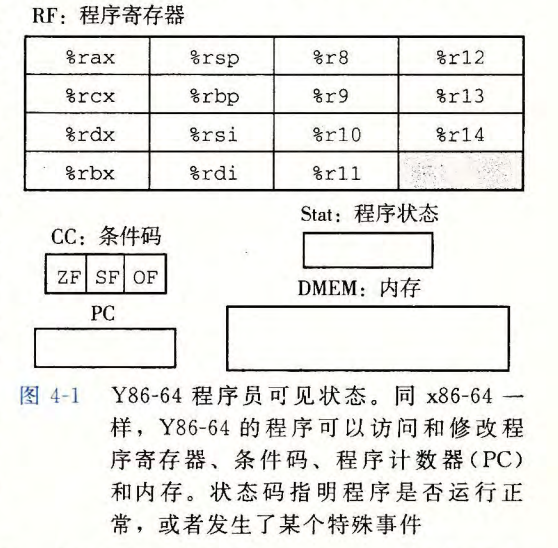

与 x86-64 相比，减少了一个程序寄存器（为了留出一个编码方式表示 None 寄存器）；减少了一个条件码（缺少进位标志 CF，故不支持无符号比较）。

### 指令集

Y86-64 指令集及其编码也与 x86-64 有细微差异。

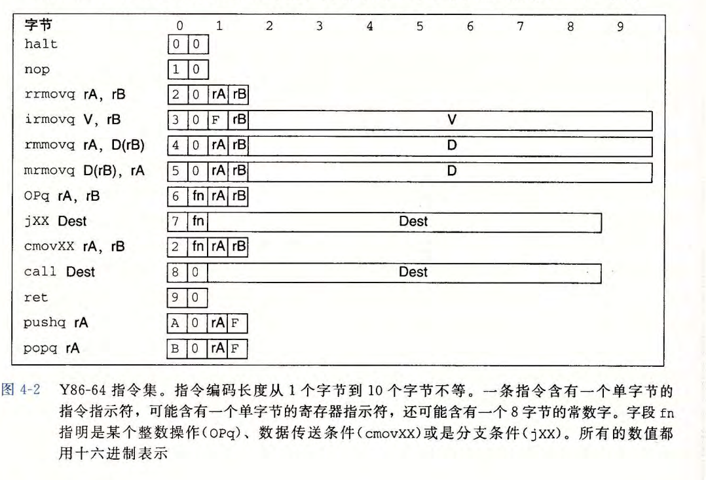

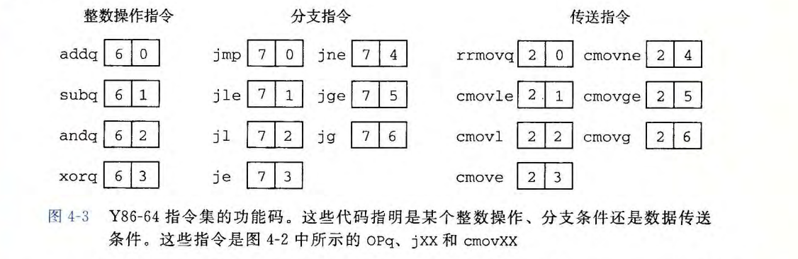

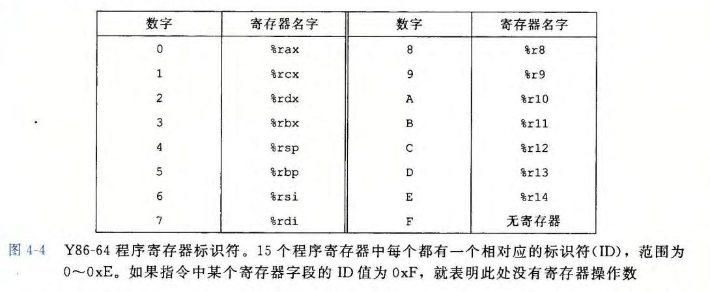

- 指令的第一个字节表示指令类型和功能，解释为 ``icode:ifun``；
- 含有寄存器的指令中，第二个字节表示寄存器ID，每个寄存器占 4 位，只有一个寄存器的指令，另外 4 位会使用 ``F`` 占位，表示无寄存器；
- Y86-64 没有 cmpq、testq 等指令，故在进行条件判断时候要注意复制操作数到新寄存器，避免修改原寄存器中的数据；
- Y86-64 中每条指令长度不超过 10 字节，所以不能直接复制立即数到内存，需要经过寄存器转一遍；
- Y86-64 中不支持相对寻址方式，使用类似 ``D(rB)`` 的绝对寻址方式；

### 编程规范

Y86-64 汇编代码要满足指令集中提到的特性，此外还有两个重要的编程规范：1)``pushq %rsp``压入的是 ``%rsp`` 的原始值；2)``popq %rsp`` 将 ``%rsp`` 设置为从内存中读出的那个值。

### 异常事件处理

Y86-64 中有 4 中异常事件：

| 名字 | 含义 |
| ------ | ------ |
| AOK | 正常操作 |
| HLT | 遇到``halt``停止 |
| ADR | 遇到非法地址 |
| INS | 遇到非法指令 |

其中，处理 ``AOK`` 之外的代码都会使处理器停止。

## 逻辑设计和硬件控制语言 HCL

这一部分主要介绍了处理器设计中的一些构件和简单的 HCL 语法。

**三种逻辑门**：

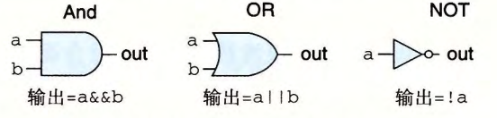

**ALU 计算单元**：

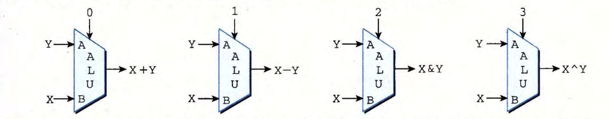

**时钟**：时钟是一个周期信号，决定什么时候要把新值加载到设备中。时钟保持低电位时，寄存器的输出保持不变，每当每个时钟到达上升沿时，值才会从寄存器的输入传送到输出。

**寄存器文件**：

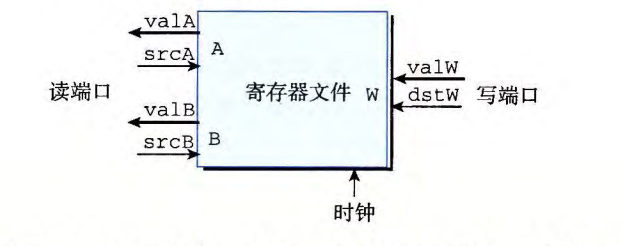

## Y86-64 的顺序实现

这一节中，首先抽象出一套阶段并以此解释每条 Y86-64 指令的执行过程；然后设计一个名为 SEQ 顺序实现方案的硬件结构。

### 阶段抽象

将 Y86-64 指令执行抽象为 6 个阶段：

- **取指**（fetch）：从内存中读取指令字节。
- **译码**（decode）：从寄存器文件读入最多两个操作数。
- **执行**（execute）：执行指令指明的操作或增减栈指针。
- **访存**（memory）：将数据写入内存或从内存中读出数据。
- **写回**（writeback）：最多可以写两个结果到寄存器文件。
- **更新 PC**（PC update）：将 PC 设置为下一条指令的地址。

为了熟悉具体地过程，将每个指令都具体分解为这 6 个阶段的操作。

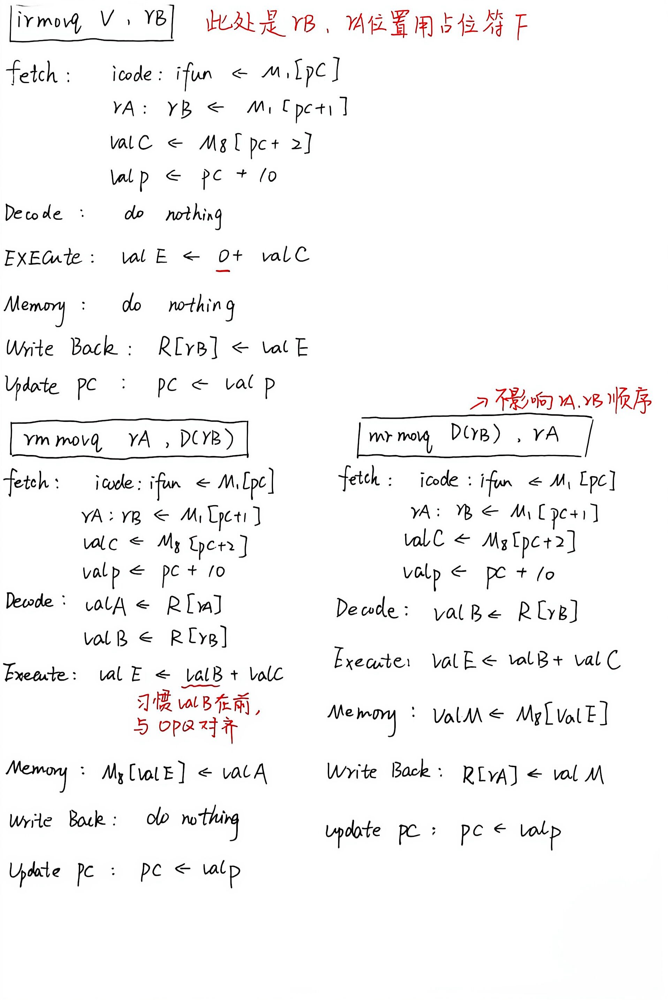

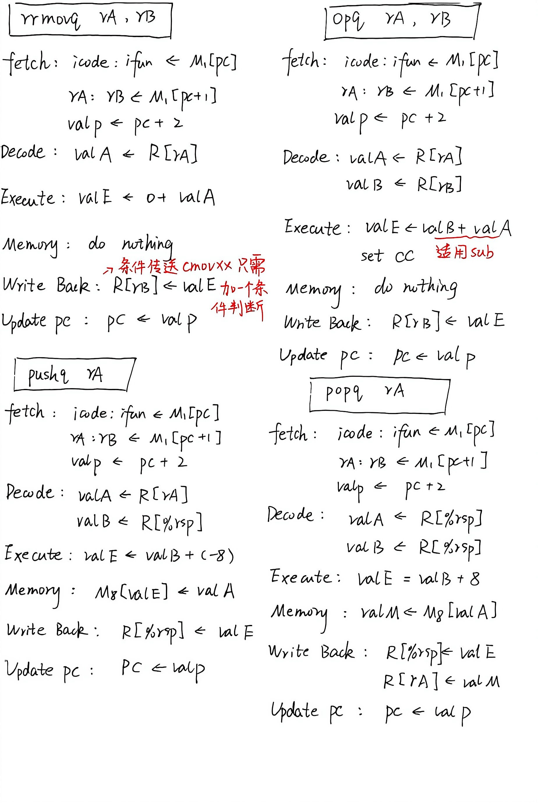

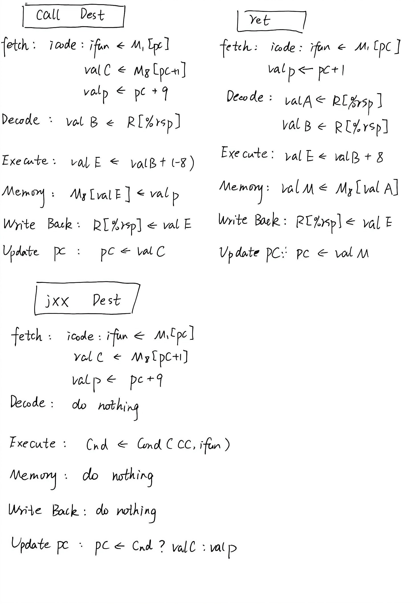

### SEQ 结构

将所有 Y86-64 指令执行抽象为 6 个阶段后，我们设计一个如下图所示的顺序实现结构：

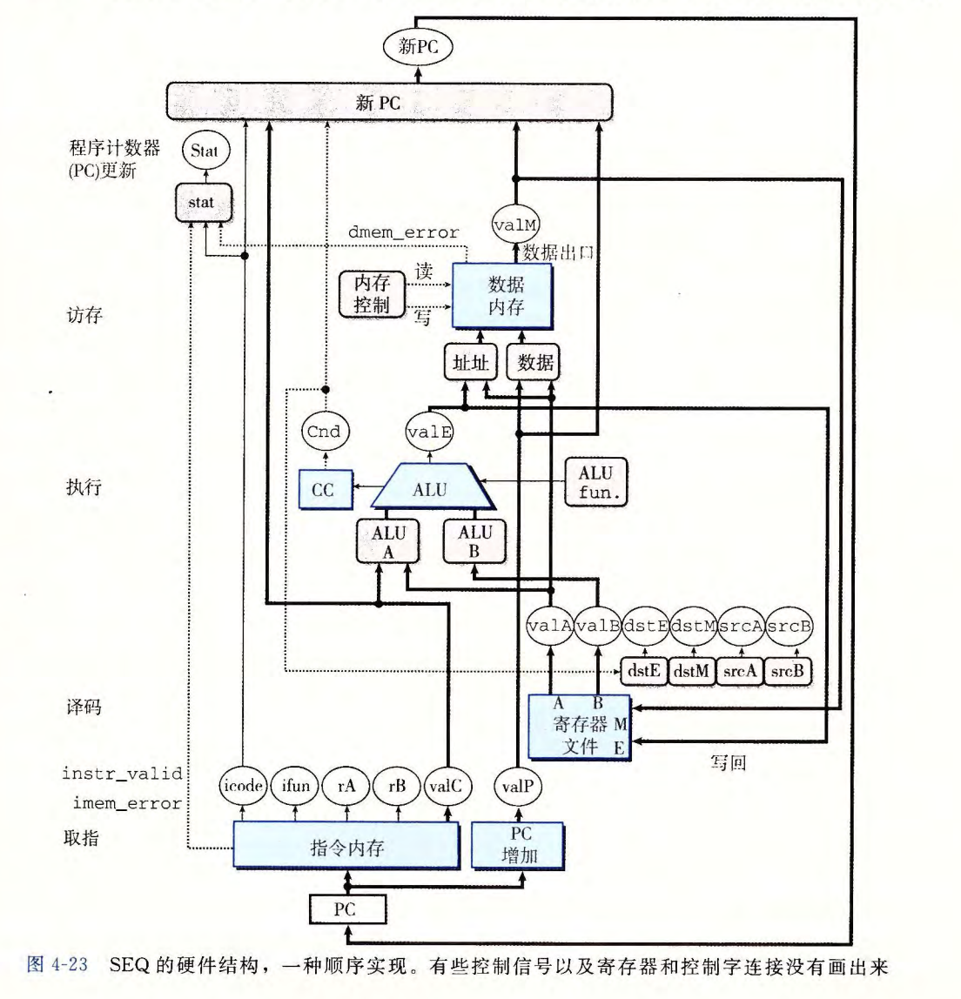

- 首先需要理解图例，本章后续的图都遵循同一套图例。宽度为字长的数据连接用中等粗度的线表示；宽度为字节或更窄的数据连接用细线表示；单个位的连接用虚线来表示。
- 图中的每一个部分和每一条连线都与上面我们写出各种指令的 6 阶段抽象相对应。只要有连线存在的数据传输，就一定可以在指令集抽象中找到某一条对应，需要注意的是并非所有指令都会使用全部的连接。以 ``ValA``、``ValB`` 为例，``ValA`` 传输到了``ALU A`` 和 ``数据``，而 ``Val B`` 只传输到了 ``ALU B``，因为所有指令集访存只会涉及到``ValA``。
- 图中也简化了一些连线，比如 ``rA`` 和 ``rB`` 应该连接到寄存器文件的读端口。

> **组合逻辑**：一种没有记忆的电路，它的输出只取决于当前的输入。

在书中讨论的 SEQ 结构中，只有上升沿在干活，下降沿没有操作。两个上升沿之间，是组合逻辑在工作：根据当前状态，信号一路传播，算出取指、译码、执行、访存、写回所需的全部结果，并稳定在各个状态元件的输入端。等下一个上升沿到来，这些结果才被"锁存"进去。所以时钟周期必须大于最长的组合逻辑路径延迟。

因为处理器从来不需要为了完成一条指令的执行而去读由该指令更新了的状态，所以可以通过寄存器和内存的时钟控制来控制处理器中活动的时序。用时钟来控制状态单元的更新，以及值通过组合逻辑来传播，足够控制 SEQ 实现中每条指令执行的计算。每次时钟由低变高时，处理器开始执行一条新指令。

如图 4-23，SEQ 的实现需要一系列的控制逻辑块，我们需要用 HCL 来进行描述，根据指令集抽象过程中的代码来设计控制逻辑块的输入输出信号。

#### （1）**Fetch**

这个阶段中，会产生 ``instr_valid`` 和 ``imem_error`` 两个信号，分别表示指令是否合法（通过前缀匹配我们定义的指令集）和指令内存是否越界。

另外，我们可以用 HCL 语言来描述另外两个信号：

```hcl

bool need_regids = 
    icode in  { IRRMOVQ, IOPQ, IPUSHQ, IPOPQ, 
                IRMOVQ, IIRMOVQ, IRMMOVQ, IMRMOVQ };

bool need_valC = 
    icode in { IIRMOVQ, IRMMOVQ, IMRMOVQ, IJXX, ICALL };

```

#### （2）**Decode** and **Write Back**

这个阶段中主要描述寄存器文件两个输入端口和两个输出端口的信号。

```hcl

    word srcA = [
        icode in { IRRMOVQ, IRMMOVQ, IOPQ, IPUSHQ } : rA ;
        icode in { IPOPQ, IRET } : RRSP ;
        1   :  RNONE; 
    ];   

    word srcB = [
        icode in { IOPQ, IRMMOVQ, IMRMOVQ } : rB;
        icode in { IPUSHQ, IPOPQ, ICALL, IRET } : RRSP;
        1  :  RNONE;
    ];

    word dstE = [
        icode in { IRRMOVQ } && Cnd : rB;
        icode in { IIRMOVQ, IOPQ } : rB;
        icode in { IPOPQ, IPUSHQ, IRET, ICALL } : RRSP;
        1 : RNONE;
    ];

    word dstM = [
        icode in { IMRMOVQ, IPOPQ } : rA;
        1 : RNONE;
    ];

```

#### （3）**Execute**

这个阶段中，需要确定 ALU 的输入端口 ``ALUA`` 和 ``ALUB``，以及 ALU 的操作码 ``alufun``，以及是否需要设置条件码。

```hcl

    word ALUA = [
        icode in { IRRMOVQ, IOPQ } : valA;
        icode in { IIRMOVQ, IRMMOVQ, IMRMOVQ } : valC;
        icode in { ICALL, IPUSHQ } : -8;
        icode in { IRET, IPOPQ } : 8;
        1 : 0;
    ];

    word ALUB = [
        icode in { IRMMOVQ, IMRMOVQ, ICALL, IPUSHQ, IRET, IOPQ } : valB;
        icode in { IRRMOVQ, IIRMOVQ } : 0;
    ];

    word alufun = [
        icode == IOPQ : ifun;
        1 : ALUADD;
    ];

    bool set_cc = icode in { IOPQ };

```

现在明白了为什么在操作栈指针时候我们需要 +(-8)，因为 ``IOPQ`` 以外的指令 ALU 默认使用加法，这下某种程度上算是一种简化。

#### （4）**Memory**

访存阶段需要确定对内存要读还是写，以及读写地址在哪。访存过程中也会产生 ``dmem_error`` 信号，表示数据内存是否越界，结合取指阶段产生的几个信号，便可以得到状态码 ``stat``。

```hcl

    bool mem_read = icode in { IMRMOVQ, IPOPQ, IRET };
    
    bool mem_write = icode in { IRMMOVQ, ICALL, IPUSHQ };

    word mem_addr = [
        icode in { IRMMOVQ, IMRMOVQ, ICALL, IPUSHQ } : valE;
        icode in { IPOPQ, IRET } : valA;
    ];

    word mem_data = [
        icode in { IRMMOVQ, IPUSHQ } : valA;
        icode in { ICALL } : valP;
    ];

    word Stat = [
        imem_error || dmem_error : SADR;
        !instr_valid : SINS;
        icode == IHALT : SHLT;
        1 : SAOK
    ];

```

#### （6）**Update PC**

这个阶段需要为下一阶段确定程序计数器新值。

```hcl

    word new_pc = [
        icode == ICALL : valC;
        icode == IJXX && Cnd : valC;
        icode in { IRET } : valM;
        1 : valP;
    ];

```

## 流水线通用原理

SEQ 定义的顺序处理结构可以正确完成每条指令的执行，但是每个单元只在整个时钟周期的一部分时间内才被使用。并且，为了能使信号在一个周期内传播所有的阶段，时钟必须非常慢。这些都大大降低了指令执行的效率。于是，很自然地想到引入流水线。

本节介绍了流水线的基本概念，为构建 Y86-64 流水线补上最后的一块拼图。

初次学习时，我混淆了两个东西，**延迟** 和 **流水线吐出一条指令的时间**。延迟是指从头到尾执行一条指令所需要的时间，流水线稳定后每个一定时间吐出一条指令，这个时间``t``用于计算``吞吐量 = 1/t * 1000ps/1ns GIPS``。

当切分阶段以构造流水线时，需要在每个阶段之间插入流水线寄存器，保存每一天指令的状态。每一个流水线阶段需要有同样的时钟周期，我们必须选择耗时最长阶段的时间作为时钟周期来保证来保证流水线的正确稳定运行。流水线的延迟等于阶段数乘以时钟周期。

上面讨论的简单流水线中，每一个流经各个阶段的``个体``都是独立的，相互之间不会产生影响，但是在 Y86-64 中，相邻指令之间会有联系，可能会发生数据相关或控制相关。

**数据相关**：某一条指令需要读取一个寄存器的数据，这个寄存器会被紧邻它的上面几条指令修改。

**控制相关**：由于分支指令的存在，流水线在执行分支指令时不知道要执行哪一个分支。

## Y86-64 的流水线实现

至此已经有了关于搭建 Y86-64 流水线的基础，本节将从改进的 SEQ+出发，过渡到 PIPE-，最后引出 PIPE 结构。

### SEQ+

SEQ+ 相对于 SEQ 的改进是做了``电路重定时``，将 PC 的计算挪到取指阶段，在一个时钟周期开始时执行，从而不再需要一个专门的硬件寄存器来存放程序计数器。

> **重定时**：改变了一个系统的状态表示，但是并不改变它的逻辑行为。通常用它来平衡一个流水线系统中各个阶段之间的延迟。

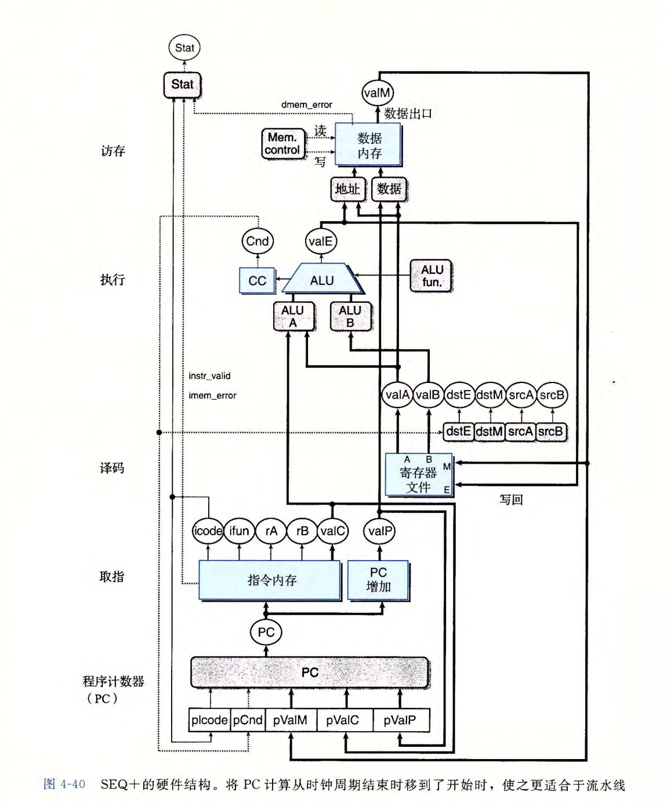

> 学习这一部分，我有个疑问，为什么改变 Update PC 的顺序会使之更适合流水线？
>
> SEQ 把唯一的状态寄存器放在 PC 上，中间没有可插入流水线寄存器的"边界"。SEQ+ 把寄存器挪到上一条指令的各个结果上，让取指阶段变成和其他阶段一样的从寄存器读输入、算输出的形态，这样把寄存器扩展成每级一份，就得到了流水线。

### PIPE-

为了构建流水线，需要在 SEQ+的各个阶段之间插入流水线寄存器，并对信号重新排列。约定使用大写字母表示流水线寄存器，小写字母表示流水线各个阶段。

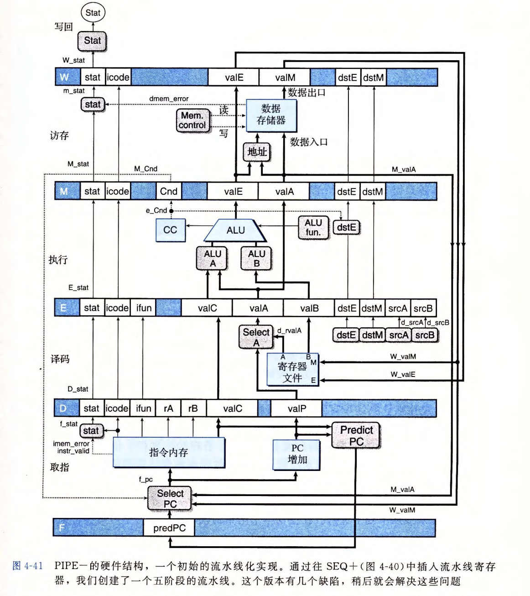

#### PIPE- 结构图的细节

与 SEQ+ 相比，注意到 PIPE-多了一个``Select A`` 的块，它接收``valP`` 和 ``valA``，这样设计是因为只有 ``call`` 和跳转指令在不需要跳转时在后续的阶段中用到 ``valP``，并且它们都不需要从寄存器文件中读值，所以可以合并这两个信号统一作为``valA``进入流水线，减少流水线状态数量，简化硬件设计。

PIPE- 中还有一个``Predict PC``模块，用于预测下一条指令的地址，保证每个时钟周期都有一条新指令进入流水线。我们来考虑几个特殊的指令：

- ``call``：指令后下一条指令的地址为``valC``，可以看到图中从指令内存单元连到``valC``的线有一个分支到了 ``Predict PC``，这在取指后就可以确定。
- ``ret``: 指令的下一条指令要从内存中读取函数返回地址后才可以确定，可以看到图中 ``W_valM`` 有一条线连到了 ``Predict PC``，这需要等到 ``ret`` 指令通过了 ``Memory`` 后才可以确定。
- ``jxx``: 条件转移中，需要等到指令通过 ``Execute`` 后才可以确定是否发生跳转，如果不跳转下一条指令位置需要通过 ``valP`` 确定，如果跳转，那就是 ``valC``。可以看到图中 ``M_valA``有一条线连到了 ``Predict PC``。

根据上面的讨论，除了 ``ret`` 和 ``jxx``（不跳转），其他所有指令在取指阶段就可以计算出 PC，对于这两中特殊情况，需要设计另外的规则来正确处理，本节中一笔带过来分支预测技术和针对 ``ret``的暂停技术，这为 PIPE 中要处理的控制问题埋下了伏笔。

#### 流水线中的问题

本部分详细分析流水线中存在的 hazard 和异常情况，为理解 PIPE 的设计提供基础。

首先，介绍两种技术。

##### (1)**Stalling**

可以用暂停（stalling）来避免数据冒险，让一组指令阻塞在它们所处的阶段，而允许其他指令继续通过流水线。每次要把一条指令阻塞在译码阶段，就在执行阶段插入一个气泡（bubble，不改变寄存器、内存、条件码、程序状态），如图所示。

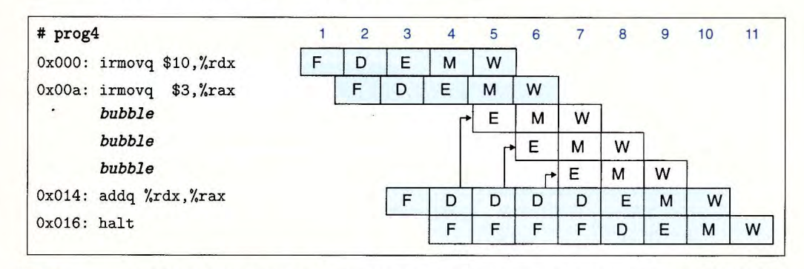

这种技术可以很容易地解决数据冒险，但是程序中一条指令更新一个寄存器，下一条指令使用被更新的寄存器非常常见，每次都阻塞等待，那么可想而知会多么低效，这也引出了另外一种技术。

##### (2)**Data forwarding**

数据转发（data forwarding）利用的观察是寄存器的写完成之前，其值其实已经被计算出来了，所以与其等待写完成，不如直接将要写的值传输到要使用的阶段。概括起来，数据转发就是将结果值直接从流水线的一个阶段传到较早阶段。

于是我们可以得到 5 个转发源（基于 D 中要使用时）：

| 源 | 情况 |
| ------ | ------ |
| e_valE | 需要紧邻前一条指令的 ALU 结果 |
| m_valM | 需要前面第 2 条指令的访存结果 |
| M_aavalE | 需要前面第 2 条指令的 ALU 结果 |
| W_valE | 需要前面第 3 条指令的 ALU 结果 |
| W_valM | 需要前面第 3 条指令的访存结果 |

##### 流水线冒险（hazard）

**数据冒险**：下一条指令会用到这一条指令计算出的结果。

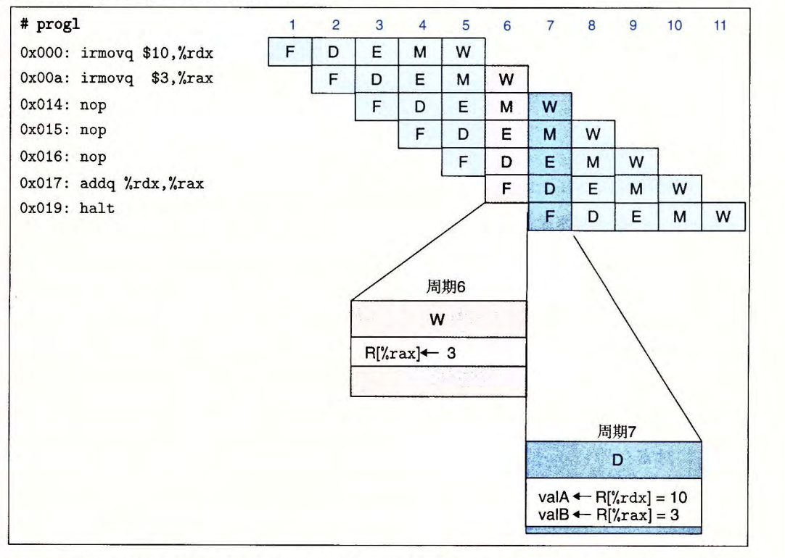

据图，要保证 D 中读取到正确的值，上一条修改相关寄存器的命令此时必须要完成 W，即如果一条指令的操作数被它前面三条指令中的任意一条改变的话，就会发生数据冒险。

**加载/使用数据冒险**：一条指令存内存中取出寄存器的值，下一条指令需要该值作为源操作数。

由于 D 和 M 之间还隔了一个E，所以这种情况我们无法直接使用数据转发，还需要结合暂停：将译码计算中的指令暂停一个周期，向执行阶段中插入一个气泡。这样等到下一个周期，就可以转发 `m_valM`到译码阶段使用。

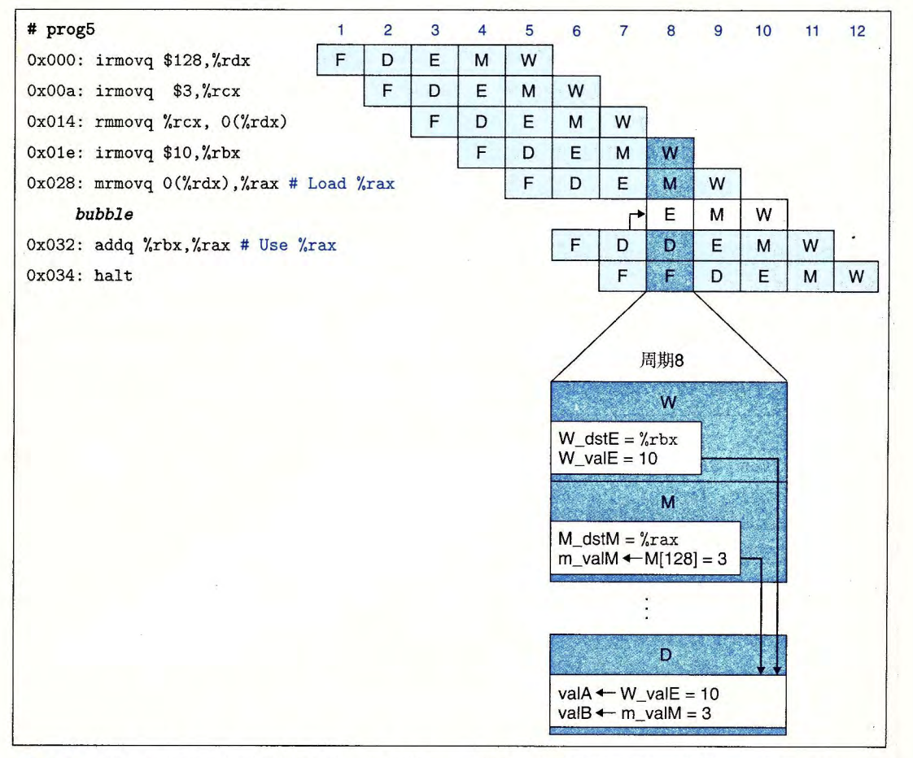

**控制冒险**：一条指令要确定下一条指令的位置。

当处理器无法根据处于取值阶段的当前指令来确定下一条指令的地址时，就会出现控制冒险。根据前面我们考察的几种特殊情况，只有``ret`` 和条件跳转会发生，而且后一种情况只有在条件跳转方向预测错误时才会造成麻烦（一般情况，处理器会直接预测跳转指令的下一条指令时跳转分支）。

对于``ret``，只有等到其访存结束后才能得到下一条指令位置，所以当``ret``经过译码、执行和访存阶段时，流水线应该暂停，在处理过程中插入三个气泡，当访存结束后，转发 ``W_valM``到取指阶段。

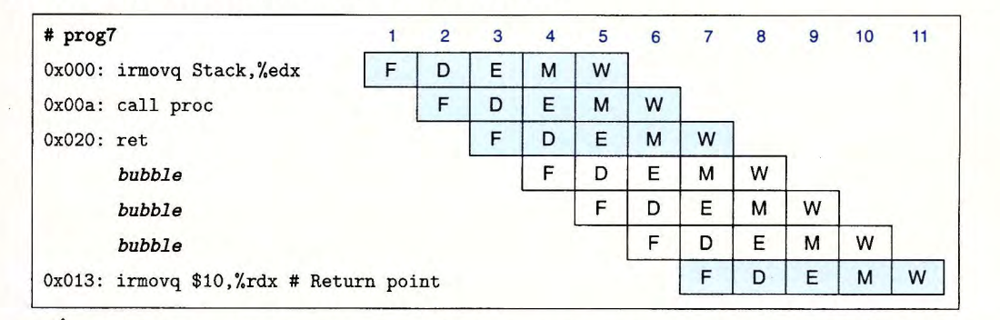

> 这里我初次学习时有一个疑问：为什么转发 ``W_valM``而不是 ``m_valM``，按理说后者更快？
>
> PIPE 为了缩短关键路径，刻意把 ``ret`` 的返回地址延迟到 W 阶段才使用。用 ``m_valM`` 在功能上其实也能拿到正确地址，问题出在时序，而不是正确性。如果使用 ``m_valM``，同一个周期里会形成一条很长的组合路径：``M_valE 作为地址 → 数据内存读 → m_valM → PC 选择 → 指令内存读（取指）``，也就是一个周期内要先串联完成读数据内存，再接着做读指令内存。这两次存储器访问本来分别在 M 和 F 两个阶段并行完成，现在被串成一条，时钟周期至少要变成两次内存访问延迟之和。

对于预测错误的分支，条件跳转指令要在 E 阶段结束后才能知道是否预测正确，如果预测错误，这个使用流水线已经插入了两条错误指令，分别在 F 和 D 阶段，下一个周期会进行到 D 和 E 阶段，所以此时需要往 D 和 E 阶段插入气泡，并同时取出跳转指令后面的指令，从而取消前面两条错误的指令。

> 在学这部分时，我有个疑问：如果跳转到的错误分支后面跟着的时 ``ret`` 指令会不会发生问题？
>
> 跳转指令在 E 后就可以发现错误，此时 ``ret`` 进行到 D，并不会发生修改指针，读取内存等行为，后续会被取消，不会产生影响。

##### 异常情况

本章定义的 Y86-64 指令集在可能发生三种内部异常：（1）``halt`` 指令，（2）有非法指令和功能码组合的指令，（3）取指或数据读写试图访问一个非法地址。

在流水线化的系统中，异常处理需要考虑一些细节：

- 可能会有多条指令会引起异常，逻辑上流水线中最深的指令引起的异常，优先级最高；
- 取出一条指令，开始执行时，导致了一个异常，而后来由于分支预测错误，取消了该指令，那么不应该停止；
- 异常指令发生后，后面的指令不应该再更新系统状态；

在流水线寄存器中加入的``stat``状态码可以处理上面这些细节。

### PIPE

现在，已经做好了所有的基础准备，可以开始构建 PIPE 结构。

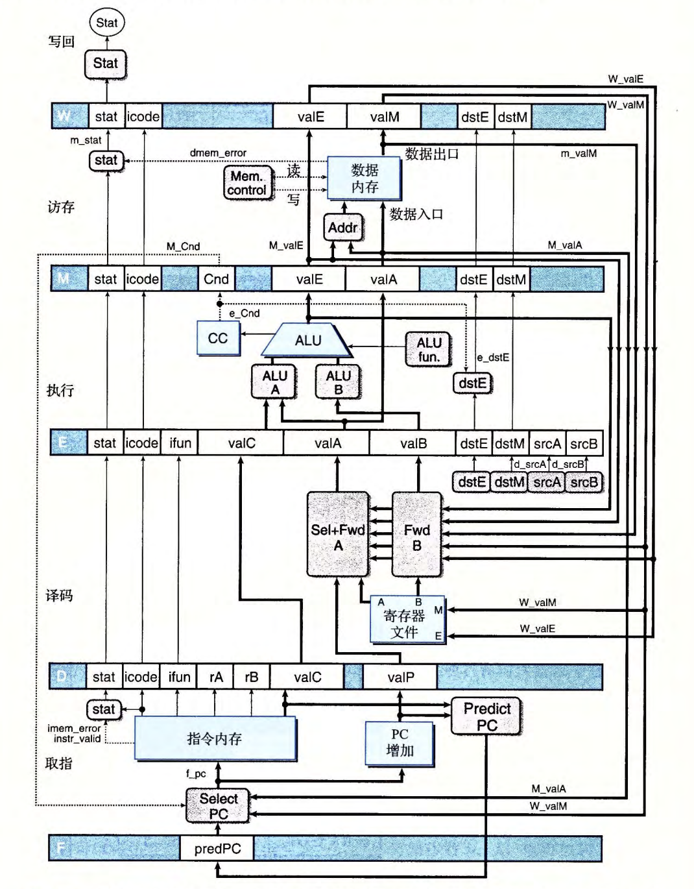

PIPE 中加入了数据转发逻辑，所以看上去连线变得很复杂。学习完这部分后，应该能完全理解上面这幅图中每一个模块和每一条线的来历和作用。下面，我们拆开 PIPE 结构，逐个分析每个阶段。

#### PC选择和取指

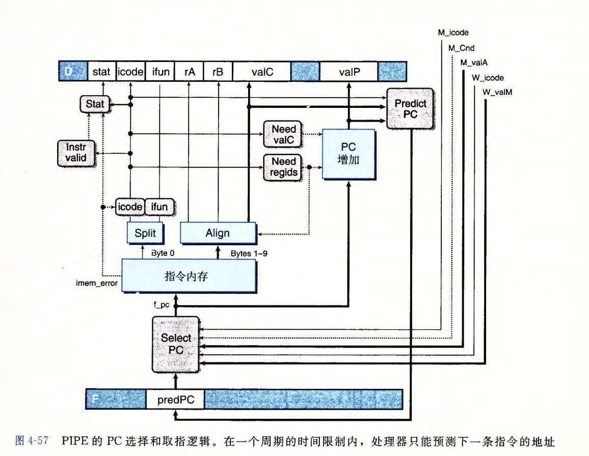

PC 选择逻辑从三个程序计数器源中选择：

- 当一条预测错误的分支进入访存时，此时执行结束发现错误，从 ``M_valA`` 返回 ``valP``；
- ``ret`` 进入 W 时，返回从 M 时读取的函数返回地址，从 ``W_valM`` 返回；
- 其他情况，使用 ``F_pred_pc`` 的值；

于是可以写出：

```hcl

    word f_pc = [
        M_icode == IJXX && !M_Cnd : M_valA;
        W_icode == IRET : W_valM;
        1 : F_pred_pc;
    ];

    word f_predPC = [
        f_icode in { IJXX, ICALL } : f_valC;
        1 : f_valP;
    ];

    word f_stat = [
        imem_error : SADR;
        !instr_valid : SINS;
        f_icode == IHALT : SHLT;
        1 : SAOK
    ];

```

这样就可以理解图中连接到 ``Select PC`` 的几根线以及 ``Predict PC`` 连接到 F 的线。从指令内存中取指后，进行的处理逻辑与 SEQ 类似，然后把提取的数据传送到流水线寄存器 D。

有一个细节：stat 会随着流水线传输，直到在写回阶段才会更新处理器状态。这是因为：（1）可能异常情况是由于分支预测错误导致的，后续会被取消；（2）异常处理需要保证流水线中所有未完成的指令都能正确处理。

#### 译码和写回

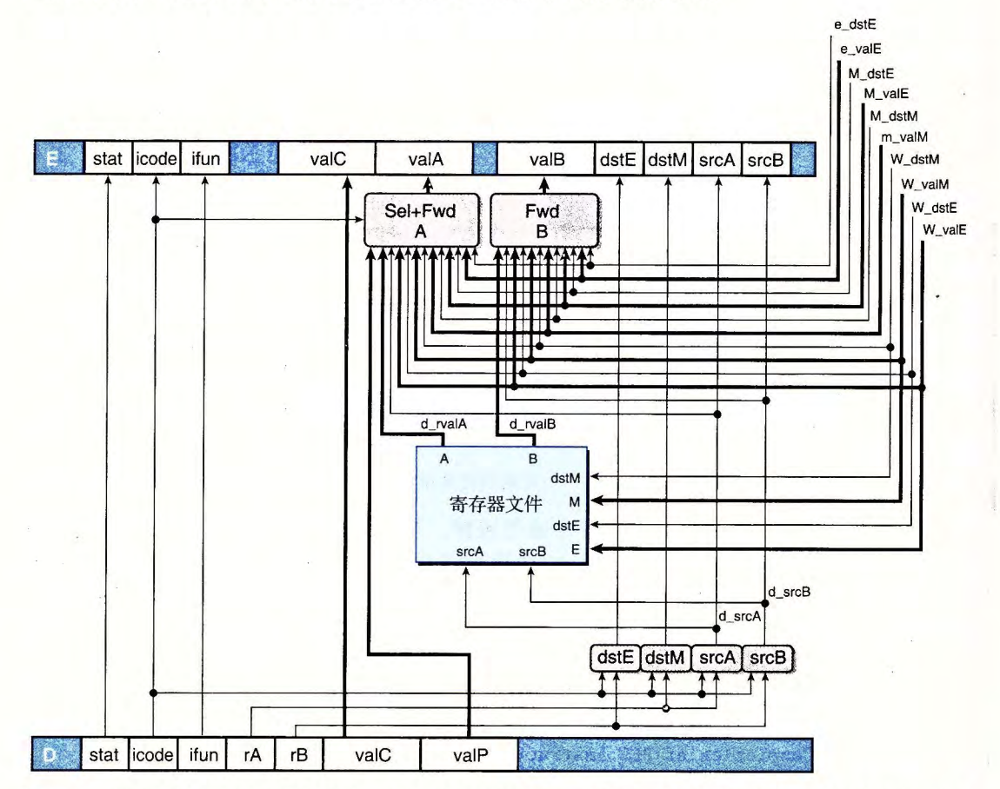

这部分图中线很杂，需要花点功夫。

回顾之前提到的 data forwarding 中的 5 个转发源，每个转发源对应一个寄存器 ID 以及用来表示``valA``、``valB`` 对应寄存器的 ``srcA``、``srcB``。因此，``Sel+Fwd A`` 一共接了 ``2+10+1=13``根线，``Fwd B`` 一共接了 ``1+10+1=12`` 根线。

寄存器文件写端口连的线分别是 M 和 E 端口需要写入的值和对应的寄存器ID，所以一共有 4 根线。

D 中 ``rA`` 连到了 ``srcA`` 和 ``dstM``。``srcA`` 不必多说，用于读取寄存器文件中的值，得到 ``valA``；``dstM`` 是因为 ``mrmovq`` 和 ``popq`` 指令有 ``R[rA] <- valM`` 的操作。

D 中 ``rB`` 连到了 ``srcB`` 和 ``dstE``。类似地，``srcB`` ，用于读取寄存器文件中的值，得到 ``valB``；``dstE`` 是因为 ``irmovq``、``rrmovq``、``opq`` 指令有 ``R[rB] <- valE`` 的操作。

D 中的其他字段比较理解，``stat``、``icode``、``ifun``、``valC``直接传递到 E 中，``ValP``进入 `Sel+Fwd A`中。

于是，可以得到

```hcl

    word d_dstE = [
        D_icode in { IRRMOVQ, IIRMOVQ, IOPQ } : D_rB;
        D_icode in { IPUSHQ, IPOPQ, ICALL, IRET } : RRSP;
        1 : RNONE;
    ];

    word d_dstM = [
        D_icode in { IMRMOVQ, IPOPQ } : D_rA;
        1 : RNONE;
    ];

```

``d_valA`` 的 HCL 代码比较特殊，我们需要考虑 5 个转发源的优先级：

```hcl

    word d_valA = [
        D_icode in { ICALL, IJXX } : D_valP;
        d_srcA == e_dstE : e_valE;
        d_srcA == M_dstM : m_valM;
        d_srcA == M_dstE : M_valE;
        d_srcA == W_dstM : W_valM;
        d_srcA == W_dstE : W_valE;
        1 : d_rvalA;
    ];

```

首先，如果是 ``call`` 或者跳转指令，直接使用 ``D_valP``。

其次流水线化的实现应该总是给出最早流水线阶段中的转发源以较高的优先级，因为它保持着程序序列中设置该寄存器的最新的指令。所以优先级：``e 中传输的数据 > M 中传输的数据 > W 中传输的数据``。那么，现在我们只需分别考虑 M 中两个转发源的相对优先级和 W 中两个转发源的相对优先级。

对于 ``M_dstM`` 和 ``M_dstE``，回顾 Y86-64 中 `popq %rsp` 指令的约定，需要将 `%rsp` 设置为从内存中读出的值，而不是在执行阶段中更新的栈指针，所以如果译码阶段需要接收来自访存阶段的数据转发时，优先级``M_dstM > M_dstE``。

对于 ``W_dstM`` 和 ``W_dstE``，还是考虑 ``popq %rsp``指令的约定，如果译码阶段需要接收来自写回阶段的数据转发时，优先级``W_dstM > W_dstE``。

最后，还有一个细节，为什么是 `e_dst` 而不是 `E_dst`？需要考虑条件传送指令 ``cmovXX``，如果条件不成立就不发生转发，此时 `e_dst = RNONE` 不等于 `E_dst`。

类似地，可以写出

```hcl

    word d_valB = [
        d_srcB == e_dstE : e_valE;
        d_srcB == M_dstM : m_valM;
        d_srcB == M_dstE : M_valE;
        d_srcB == W_dstM : W_valM;
        d_srcB == W_dstE : W_valE;
        1 : d_rvalB;
    ];

```

另外，写回阶段结束后，需要更新处理器状态：

```hcl

    word Stat = [
        W_stat == SBUB : SAOK;
        1 : W_stat;
    ]

```

#### 执行

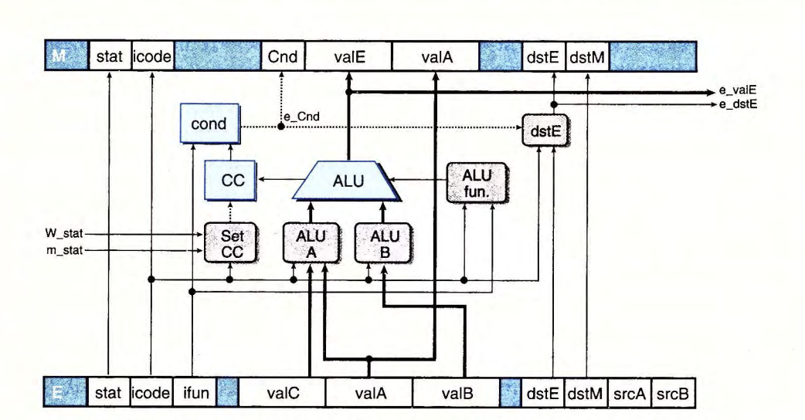

根据 `icode` 和 `ifun` 选择 `ALU A`、`ALU B` 和 `ALU fun.`；

根据 `W_stat` 和 `m_stat` 来决定是否设置条件码，即处理器状态异常或在访存阶段中发生内存越界时，就应该停止后续指令对处理器状态的更新；

根据 `CC` 算出 `Cnd`，沿流水线传递的同时参与对 `dstE` 的更新；

有一个细节：不需要担心预测分支错误运行的代码会错误的设置 CC，因为错误分支的代码永远不会达到访存阶段！

> 学习这部分时，我有个疑问：为什么访存阶段的信号 `m_stat` 可以传到同一个时钟周期在工作的执行阶段中设置条件码？
>
> 流水线的阶段不是按时间依次运行的程序步骤。一个周期内，F、D、E、M、W 五段组合逻辑同时在各自的输入上计算，输入来自上一个周期末锁存的流水线寄存器。信号在电路里沿导线传播，只要最终在周期末的时钟边沿之前稳定下来，就能被正确锁存。

#### 访存

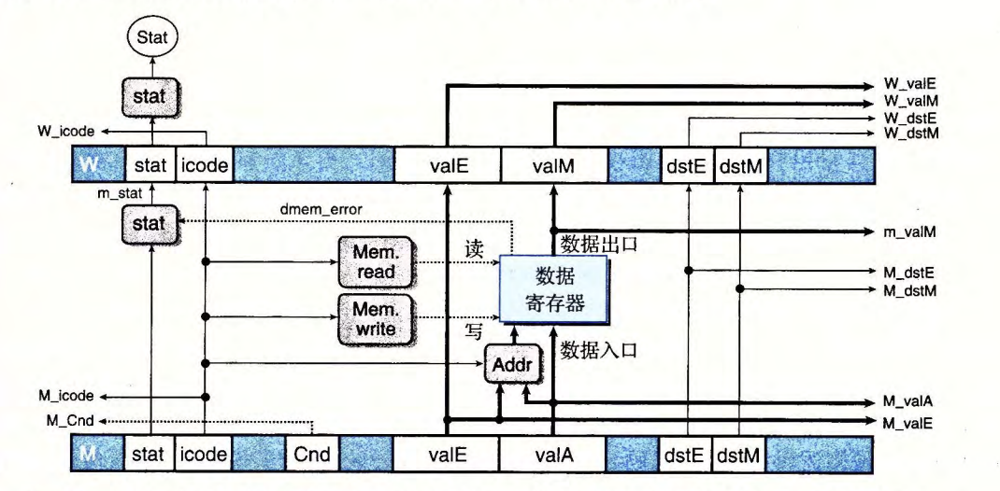

图中的线路比较简单，包括 M m W 的数据转发，读内存是否越界的信号等。

分析到这里，每条线的逻辑基本都已经清晰。
再返回去看 PIPE 的完整结构，会发现豁然开朗！

#### 控制逻辑

##### 分析

构建了完整 PIPE，最后还需要加入控制逻辑来保证每一条指令可以按我们预期的正确运行，并且处理 hazard 和各种异常情况。

回顾前面所讨论的，控制逻辑需要考虑四个问题：

（1）**加载/使用冒险**：在一条从内存中读出一个值的指令和一条使用该值的指令之间，流水线必须暂停一个周期。

（2）**处理`ret`**：流水线必须暂停直到`ret`指令到达写回阶段。

（3）**预测错误的分支**：在分支逻辑发现不应该选择分支之前，分支目标处的几条指令已经进入流水线了。必须取消这些指令，并从跳转指令后面的那条指令开始取指。

（4）**异常情况**：当一条指令导致异常，要禁止后面的指令更新程序员可见状态，并且在异常指令到达写回阶段时，停止执行。

流水线控制机制：

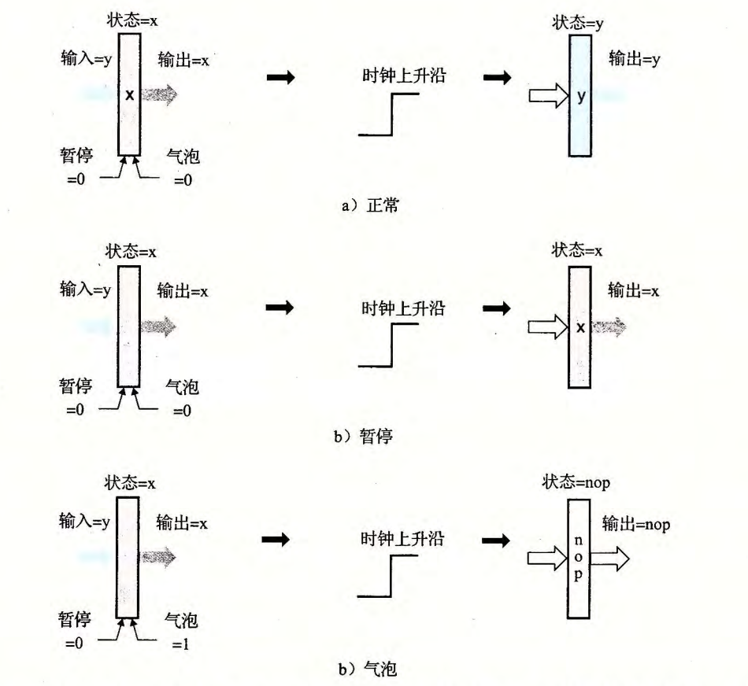

- 正常条件下，当时钟上升沿到来，寄存器的状态和输出被设置成输入的值；
- 暂停模式下，状态保持之前的值不变；
- 气泡模式下，用`nop`操作的状态覆盖当前状态；

可以用这三种模式来概括如何设计控制逻辑：

| 条件 | F | D | E | M | W |
| --- | --- | --- | --- | --- | --- |
| 处理 `ret` | 暂停 | 气泡 | 正常 | 正常 | 正常 |
| 加载/使用冒险 | 暂停 | 暂停 | 气泡 | 正常 | 正常 |
| 预测错误的分支 | 正常 | 气泡 | 气泡 | 正常 | 正常 |

在任意一个时钟周期内，发生更多个特殊情况的组合也是大概率事件。

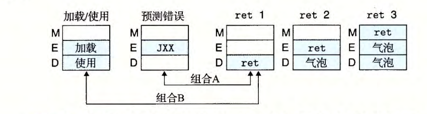

根据分析，只有组合 A 和组合 B 不互斥。组合 A 中，跳转分支是 `ret`，但实际不需要跳转；组合 B 中，加载指令加载 `%rsp`，然后紧接着 `ret`。

**组合 A**：

| 条件 | F | D | E | M | W |
| --- | --- | --- | --- | --- | --- |
| 处理 `ret` | 暂停 | 气泡 | 正常 | 正常 | 正常 |
| 预测错误的分支 | 正常 | 气泡 | 气泡 | 正常 | 正常 |
| 组合 | 暂停 | 气泡 | 气泡 | 正常 | 正常 |

与普通处理预测错误分支相比，取指阶段是暂停。在下一个周期，PC 选择逻辑会选择跳转后面那条指令的地址，而不是预测程序计数器，所以流水线寄存器 F 发生了什么都无所谓。故，流水线可以正常处理这种情况。

**组合 B**：

| 条件 | F | D | E | M | W |
| --- | --- | --- | --- | --- | --- |
| 处理 `ret` | 暂停 | 气泡 | 正常 | 正常 | 正常 |
| 加载/使用冒险 | 暂停 | 暂停 | 气泡 | 正常 | 正常 |
| 组合 | 暂停 | 暂停 + 气泡 | 气泡 | 正常 | 正常 |
| 期望 | 暂停 | 暂停 | 气泡 | 正常 | 正常 |

因此，可以发现 PIPE 并没有正确处理这种情况，需要我们写 HCL 时特殊处理。

##### 实现

经过上面的讨论，PIPE 的控制逻辑已经清晰了，可以总结出：

```hcl

    bool F_stall = 
        E_icode in { IMRMOVQ, IPOPQ } && E_dstM in { d_srcA, d_srcB } ||
        IRET in { D_icode, E_icode, M_icode };
    
    bool D_stall = 
        E_icode in { IMRMOVQ, IPOPQ } && E_dstM in { d_srcA, d_srcB };

    bool D_bubble = 
        (E_icode == IJXX && !e_Cnd) ||
        !(E_icode in { IMRMOVQ, IPOPQ } && E_dstM in { d_srcA, d_srcB }) &&
        IRET in { D_icode, E_icode, M_icode };

    bool E_bubble = 
        (E_icode == IJXX && !e_Cnd) ||
        E_icode in { IMRMOVQ, IPOPQ } && E_dstM in { d_srcA, d_srcB };

    bool M_bubble = m_stat in { SADR, SINS, SHLT } || W_stat in { SADR, SINS, SHLT };

    bool W_stall = W_stat in { SADR, SINS, SHLT };

```

### To be continued

至此，已经讨论完了本章大部分内容，剩下内容是性能分析和 PIPE 的 furture work，摘出几个自认为重要的点，其他内容不再赘述。

$$
CPI = \frac{C_i+C_b}{C_i}
$$

PIPE 还不能完成多周期指令，比如整数乘法和除法；

PIPE 还没有实现与存储系统的接口，忽略了自我修改代码造成的冒险。
